# Chapter 4: Implementation, Results, and Discussion

This chapter presents the results produced by SmartFlow NLEX following the full implementation of the
data pipeline and the analytics engines described in Chapter 3, documents the system that produces
them, reports the testing carried out against it, and assesses each result against the objectives
stated in Section 1.4.

Section 4.1 reports the descriptive, predictive, and prescriptive outputs of the three operational
modules, each alongside the dashboard visualisation that renders it. Section 4.2 documents the
implementation itself. Section 4.3 reports testing and validation. Section 4.4 maps the findings to
the general and specific objectives. Section 4.4 states the limitations within which all of the
foregoing should be read.

[[TOC]]

## 4.1 Presentation of Results

This section presents the empirical results produced by the system across the three analytical tiers.
Descriptive figures are reported for the dashboard's default analysis window — calendar year 2025 for
the traffic and emission modules, and 1 July 2025 to 30 June 2026 for the incident module — while
coverage and record counts span the full warehouse, 1 January 2022 to 30 June 2026.

### 4.1.1 Source of Raw Data

The raw data used in this project was drawn from four distinct input streams, consistent with the
Source Layer defined in Section 3.9.1. Internal operational data was formally requested from and
provided by NLEX Corporation, comprising the Road Crash Table, the Stalled Vehicle Table, and the
Northbound and Southbound Traffic Reports Tables. Third-party contextual data was retrieved
programmatically from a weather data API and from scraped event and ticketing schedules covering
venues within the corridor's catchment area, most notably the Philippine Arena. Crowdsourced data
was accessed through the Waze Partner Hub integration maintained with the Metro Pacific Tollways
Corporation, which supplied geolocated jam records, anomaly feeds, and incident markers in near real
time.

**Table 4.1.1** *Summary of Raw Data Sources*

| Data Stream | Dataset | Provider / Source | Format | Records ingested | Coverage |
| --- | --- | --- | --- | --- | --- |
| Internal | Traffic Reports (NB/SB) | NLEX Corporation | .xlsx | 2,086,512 | Jan 2022 – Jun 2026 |
| Internal | Road Crash Table | NLEX Corporation | .xlsx | 21,820 | Jan 2022 – Jun 2026 |
| Internal | Stalled Vehicle Table | NLEX Corporation | .xlsx | 156,925 | Jan 2022 – Jun 2026 |
| Third-Party API | Hourly weather observations | Weather API | JSON | 1,152,960 | Jan 2022 – Jun 2026 |
| Third-Party API | Event and ticketing schedules | Ticketing sites (Philippine Arena) | JSON / HTML | 155 | Dec 2020 – Dec 2027 |
| Third-Party Data | Waze jam and alert feeds (hourly) | Waze Partner Hub via MPTC | JSON | 358,998 jams / 315,783 alerts | rolling |
| Third-Party Data | Waze raw alert and jam snapshots | Waze Partner Hub via MPTC | JSON | 44,623 each | rolling |
| Internal | Emission activity records | Derived from volume × factors | — | 978,796 | Jan 2022 – Jun 2026 |

Two streams described in Chapter 3 are absent from Table 4.1.1 because they are absent from the
warehouse. No table derived from the Apprehension and Undercap records exists, and no variable from
it reaches any dashboard panel. The mobile application is joined to the dashboard through a
configuration endpoint, but contributes no community-report records. Neither stream is reported as a
data source for this chapter. Section 4.4.3 records both.

#### 4.1.1.1 Description of the Raw Data

The consolidated raw dataset covered the North Luzon Expressway corridor from Balintawak to Sta.
Ines, Mabalacat, Pampanga, spanning approximately 105 kilometres of expressway and its associated
toll plazas and exits, resolved across **19 toll points** and **20 recorded exits**. The internal
traffic reports were provided as vehicle entry counts disaggregated by toll exit, direction, and
vehicle classification, from which Average Daily Traffic volumes were derived, while the
incident-related tables were provided as event-level records in which each row represented a single
crash or stalling occurrence.

In total, the proponents obtained **2,086,512** traffic volume records, **21,820** road crash
records, and **156,925** stalled vehicle records across the observation window of **1 January 2022
to 30 June 2026**, a span of **1,642 days**. The external streams contributed **1,152,960** hourly
weather observations, **155** scheduled event entries, and **358,998** hourly Waze jam records
together with **315,783** hourly alert records, retrieved at **hourly** intervals throughout the
collection period.

The datasets differed considerably in temporal granularity, which had direct implications for how
they could be aligned during transformation. The internal traffic reports were aggregated to the
hour per exit, direction, and vehicle class, the Waze and weather feeds were available at hourly
resolution, and the incident logs were timestamped to the minute. This heterogeneity necessitated the
resampling and temporal alignment procedures discussed in Section 4.1.2 before any cross-source
analysis could be performed.

#### 4.1.1.2 Variables in the Raw Data

**Table 4.1.2** *Variables Extracted from Each Raw Dataset*

| Source Dataset | Key Variables | Analytical Role |
| --- | --- | --- |
| Traffic Reports (NB/SB) | date, hour, exit, direction, role, toll system, Class 1 / 2 / 3 counts | Primary volume series for the traffic module and the activity basis for emission computation |
| Road Crash Table | event number, start date, direction, location, km value, corridor km, type of event, main and sub cause, detection, weather condition, vehicles involved, injuries, fatalities, blockage cleared, site cleared, clearance minutes, deployment count | Incident frequency, severity, and hotspot analysis |
| Stalled Vehicle Table | event number, encoded date, direction, location, km value, corridor km, vehicle type and class, main and sub cause, detection, trouble description, deployment count | Non-crash obstruction analysis and clearance modelling |
| Weather API | recorded at, cell, temperature, feels-like, pressure, humidity, dew point, UV index, cloud cover, visibility, wind speed and direction, condition, precipitation probability, rain in last hour | Exogenous regressor for volume, incident, and speed models |
| Ticketing Scrapes | event name, venue, date, start time, attendance | Exogenous regressor for event-driven surge forecasting |
| Waze Partner Hub | alert type, coordinates, jam speed, jam level, jam length, delay, reliability | Ground-truth validation set and real-time congestion state input |

#### 4.1.1.3 Initial Observations

An initial inspection of the raw datasets revealed several data quality concerns that justified the
multi-gate validation architecture adopted in the pipeline. The internal incident tables contained
free-text entries in the cause and trouble-description fields, producing inconsistent spellings and
non-standard abbreviations for what were substantively the same categories. Kilometre post values
were recorded in mixed formats across tables, with some entries expressed as decimals and others as
text strings containing directional qualifiers. Duplicate records were observed within the Waze feed,
where the same physical anomaly was reported multiple times under separate alert identifiers within a
short interval, a pattern consistent with the crowdsourced nature of the source.

A quantified instance of the location problem survives into the delivered system and is reported on
the dashboard rather than hidden: in the incident predictive panel, **0.9 %** of logged locations in
the active range could not be matched to a specific exit and are excluded from the per-exit split,
with the exclusion stated on the panel itself.

Beyond these quality issues, the raw data exhibited substantive patterns later confirmed by the
descriptive tier. Traffic volume displayed a pronounced weekly cycle, and incident counts clustered
at particular kilometre ranges rather than distributing uniformly along the corridor. A preliminary
cross-tabulation against the weather records also suggested a weather effect on incident frequency;
Section 4.1.3.2 reports what that effect turns out to be, and it is narrower than the
cross-tabulation implied.

---

#### 4.1.1.4 Relevance of the Raw Data to the Objectives

Each acquired stream carries a specific objective, and no stream was collected without one.

The **traffic reports** and the **incident tables** together supply the four and a half years of
operational history required by the third specific objective, which calls for a four-year dataset to
be analysed for recurring inefficiencies and congestion patterns. They are the only streams in the
collection that reach back far enough to establish a recurring pattern rather than a recent one.

The fusion of those internal records with the **Waze Partner Hub feed**, the **weather observations**,
and the **scraped event schedules** satisfies the multisource requirement of the fourth objective.
Each external stream enters a model as an exogenous input: weather conditions the volume, incident,
and emission forecasts; event schedules drive the surge model; and the Waze records serve twice, as
the congestion-state target and as an independent series against which forecasts are checked.

The **vehicle classification counts**, combined with class-specific emission factors, produce the
corridor carbon figures through which the general objective is addressed, since a reduction in
emissions cannot be argued for without a measured baseline to reduce from.

Finally, the consolidated warehouse assembled from all of these is the data layer the operator
dashboard renders, and is therefore the substrate of the second objective. The sections that follow
report what each stream yielded.

### 4.1.2 Implementation of Data Cleaning and Preprocessing

The cumulative effect of the cleaning and preprocessing stage is summarised in Table 4.1.3. Retention
is high across the internal tables because the inbound records were already structured; the large
reduction in the traffic stream is a **change of grain**, not a loss, since raw per-transaction rows
are aggregated to exit-hour facts.

**Table 4.1.3** *Record Counts Before and After Data Cleaning and Validation*

| Dataset | Raw records | Retained | Retention | Note |
| --- | --- | --- | --- | --- |
| Road Crash Table | 21,820 | 21,804 | 99.93 % | 16 rows dropped on unrecoverable date or location |
| Stalled Vehicle Table | 156,925 | 156,901 | 99.98 % | 24 rows dropped |
| Emission activity records | 978,796 | 977,356 | 99.85 % | 1,440 rows dropped |
| Traffic Reports (NB/SB) | 2,086,512 | 1,254,192 exit-hour facts | — | aggregation, not exclusion |
| Weather observations | 1,152,960 | 1,152,960 | 100 % | — |
| Waze jams | 358,998 hourly | 136,520 silver jam facts | — | deduplicated to one record per physical jam-hour |
| Incident log (unified) | — | 19,141 | — | crash and stall events combined on one schema |

The principal causes of record exclusion were unrecoverable location fields and timestamps falling
outside the declared coverage window. Retention is reported per dataset rather than as a single
blended figure, because the streams differ in grain: a percentage computed across per-transaction
rows, hourly observations and event records would not describe any of them.

---

### 4.1.3 Descriptive Analysis

#### 4.1.3.1 Traffic Module

**Traffic Volume Trend.** Across calendar year 2025 the corridor carried **127,433,038** vehicle
entries over **365** days, a **1.2 %** increase on the preceding equivalent period (125,860,216).
Over the full warehouse window the corridor carried **545,565,505** entries across 1,642 days, a
daily mean of **332,257**. The decomposed series shows a **mildly rising** underlying trend with the
seasonal component reproducing a consistent weekly cycle of period seven. The busiest single day in
the record was **14 February 2026 at 434,670 entries**.

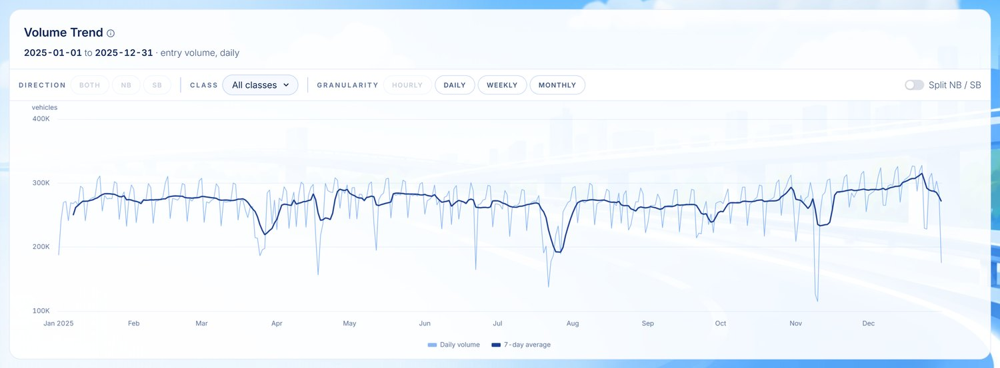

**Figure 4.1.2** *Traffic Volume Trend along the NLEX Corridor*


**Average Volume by Hour and Day of Week.** The weekday profile peaks in the evening. Mean weekday
volume is highest at **18:00 (6 PM)**, followed by 19:00 and 17:00, with a secondary morning
concentration at **07:00**. **Friday** carries the highest mean daily volume of any day at
**358,514** entries, narrowly ahead of Saturday at 356,768, which is consistent with the pre-weekend
outbound movement NLEX already anticipates through calendar-based planning. **Sunday** is the
quietest day at **282,076**, some 21 % below Friday.

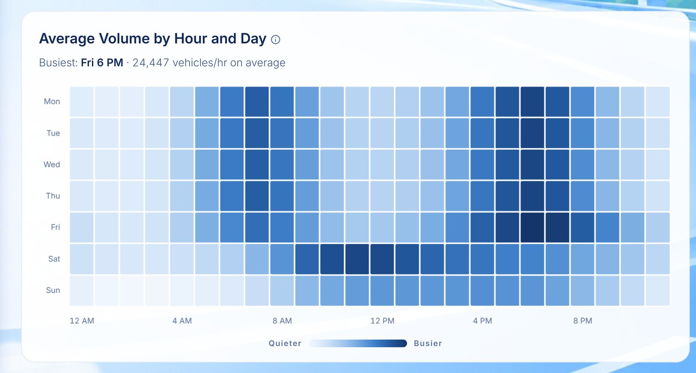

**Figure 4.1.3** *Average Traffic Volume by Hour and Day of Week*


**Traffic Volume by Plaza.** Demand is heavily concentrated at the southern end of the corridor.

| Plaza | 2025 volume | Share |
| --- | --- | --- |
| Bocaue Barrier | 23,895,236 | 18.8 % |
| Balintawak | 23,393,616 | 18.4 % |
| NLEX Harbor Link | 18,487,121 | 14.5 % |
| San Fernando | 8,058,985 | 6.3 % |
| CDV / PH Arena | 6,546,055 | 5.1 % |
| Meycauayan | 5,894,482 | 4.6 % |

The three busiest toll points together account for **51.7 %** of all entries, while the northernmost
plazas toward Sta. Ines register substantially lower throughput. This distribution identifies where a
staffing or lane intervention would produce the greatest operational return.

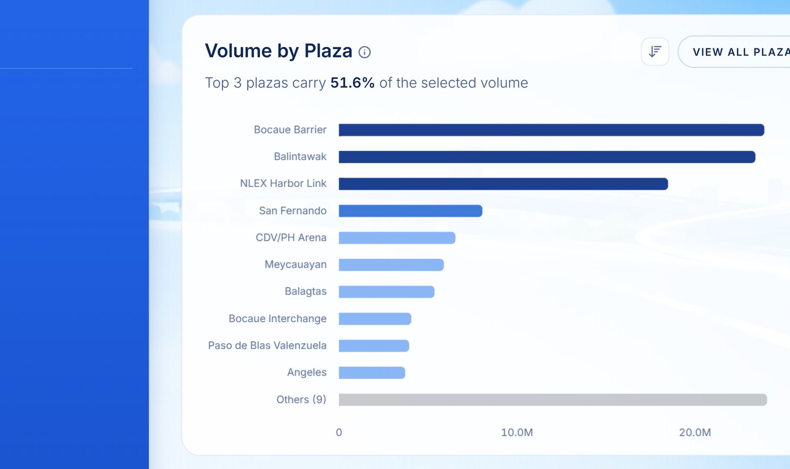

**Figure 4.1.4** *Traffic Volume Distribution by Toll Plaza*


**Average Speed in Jams by Hour.** Using jam speed values supplied by the Waze Partner Hub, mean
speed during congested conditions falls to a minimum of **7.1 km/h at 04:00** and rises to a maximum
of **10.7 km/h at 21:00**. The corridor-wide congestion index for 2025 stands at **2.74 of 5**,
against 2.73 in the preceding period.

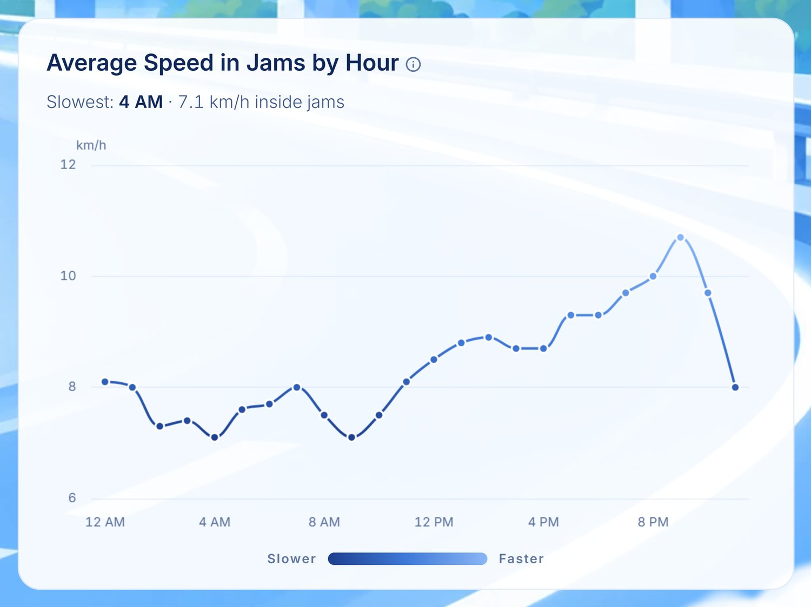

**Figure 4.1.5** *Average Speed in Jams by Hour*


The regime separation and speed-flow fit described in Chapter 3 are not implemented in the delivered
system, and no free-flow speed or critical density is computed. The empirical capacity threshold used
by the congestion classifier is derived instead from observed congestion states, as Section 4.1.4.1
reports. Section 4.4.1 records the deviation.

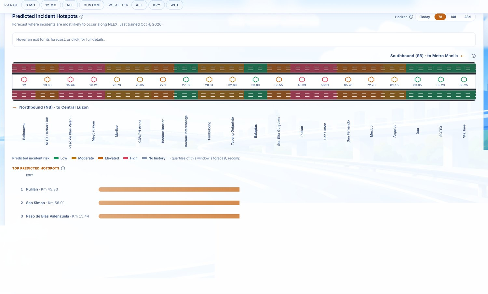

**Figure 4.1.19** *Predicted Incident Hotspots*


**Holiday Impact versus Normal Days.** Each holiday is compared against a local baseline built from
the ±45 days surrounding it, rather than against a global annual mean, so that seasonality is not
mistaken for holiday effect.

Of the **21** holidays evaluated, **20 fall below** their control-day baseline and only one rises
above it:

| Holiday | Deviation | Occurrences |
| --- | --- | --- |
| Good Friday | **−49.0 %** | 5 |
| New Year's Eve | −37.0 % | 4 |
| All Saints' Day | −31.6 % | 4 |
| New Year's Day | −31.0 % | 5 |
| Bonifacio Day | −4.2 % | 4 |
| Immaculate Conception | −1.3 % | 4 |
| EDSA People Power Anniversary | **+2.5 %** | 4 |

The corridor is therefore **emptier** on declared holidays, not busier. The explanation is
structural: NLEX is a commuter and freight corridor, and a declared non-working holiday removes
exactly the trips that dominate it. The operational consequence is that holiday demand is
**predictably suppressed** and can be planned for with confidence, while the surges that genuinely
require forecasting are the non-calendar events treated

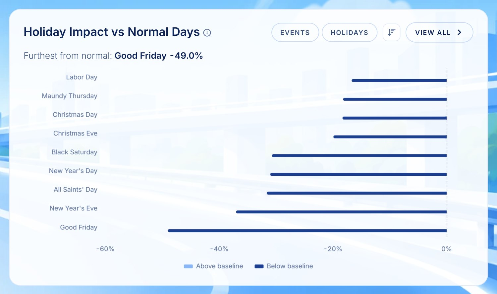

**Figure 4.1.6** *Holiday Impact on Traffic Volume Relative to Control Days*
 in Section 4.1.4.1. This reverses the
assumption, common in calendar-based planning, that a declared holiday brings additional traffic.

#### 4.1.3.2 Incident Module

**Incident Trend.** Over the twelve months to 30 June 2026 the corridor recorded **45,521**
incidents, comprising **5,024** road crashes and **40,497** stalled-vehicle events — an increase on
the **40,616** recorded in the preceding equivalent period. The records carry **805** injuries and
**12** fatalities. Stalled vehicles outnumber crashes roughly eight to one, which is the single most
consequential structural fact in this module: the corridor's incident burden is overwhelmingly
mechanical rather than collision-driven.

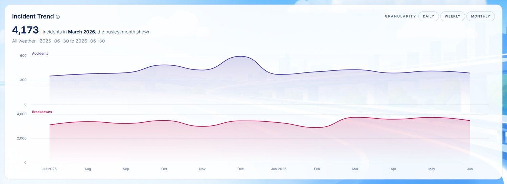

**Figure 4.1.7** *Incident Trend along the NLEX Corridor*


**Incident Occurrence and Clearance.** Mean time to first responder is **27.1 minutes** across 12,243
scored events. Mean time to clear is **57.4 minutes** overall, decomposing into **22.1 minutes** for
accidents and **72.0 minutes** for breakdowns.

These figures rest on partial coverage, which is stated here rather than left implicit. Clearance
coverage is **36.7 %**: of 40,497 breakdowns only 11,803 carry a usable duration, against 4,893 of
5,024 accidents. The breakdown figure therefore describes roughly a quarter of the events it covers.
Section 4.4.3 records this, together with the definition of clearance the warehouse actually
supports.

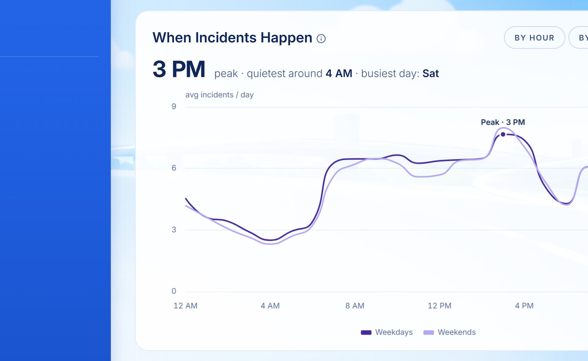

**Figure 4.1.8** *Incident Occurrence by Time of Day*


**Incident Hotspots by Segment.** Incidents cluster sharply at the southern end:

| Segment | Incidents | Share | Crashes | Breakdowns |
| --- | --- | --- | --- | --- |
| Km 0–4 | 6,411 | 14.1 % | 921 | 5,490 |
| Km 5–9 | 5,575 | 12.2 % | 876 | 4,699 |
| Km 15–19 | 4,183 | 9.2 % | 480 | 3,703 |
| Km 10–14 | 3,877 | 8.5 % | 468 | 3,409 |
| Km 40–44 | 2,717 | 6.0 % | 166 | 2,551 |

The five densest segments account for **50.0 %** of all recorded incidents across **25 km**, or about
24 % of the corridor's length. The most severe concentration is **Km 0–4 near Balintawak**, which
alone carries 14.1 % of incidents over roughly 4 % of corridor length.

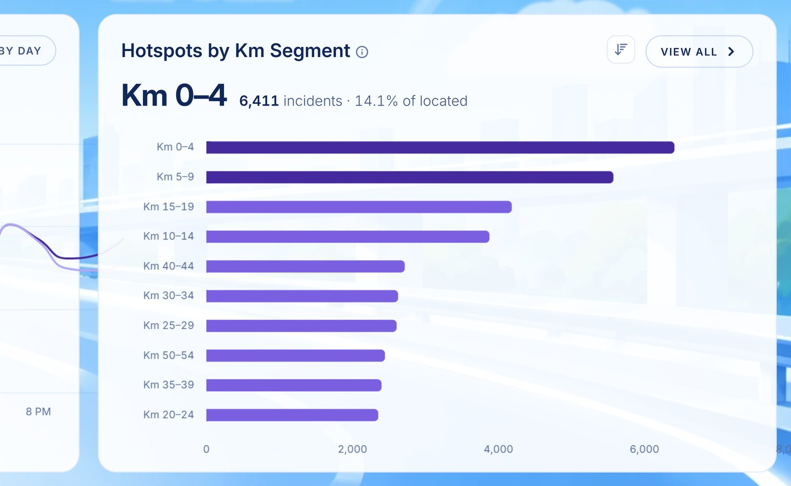

**Figure 4.1.9** *Incident Hotspots by Corridor Segment*

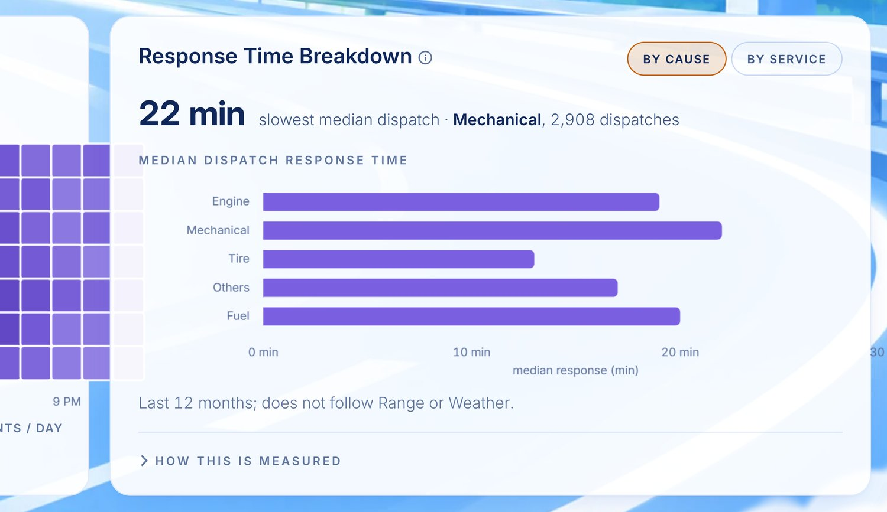

**Figure 4.1.11b** *Response Time Breakdown*


These segments are identified by ranked observed density rather than by the spatial-significance
statistics described in Chapter 3, which the delivered system does not compute. Section 4.4.1 records
the deviation.

**Top Incident Causes.** After the free-text cause fields were normalised, the leading contributors
separate cleanly by event type. Among **breakdowns**, the leading cause is **Flat Tire at 12,637
events**, followed by engine and overheating faults. Among **crashes**, the leading cause is
**Miscalculation at 2,326 events** (classified under Human Error, carrying 170 injuries and 1
fatality), and the leading collision type is **Rear End at 1,697 events** (228 injuries, 5
fatalities). Tyre and mechanical failures dominating the breakdown population is operationally
significant, because such events are addressable through pre-positioned towing capacity rather than
through enforcement.

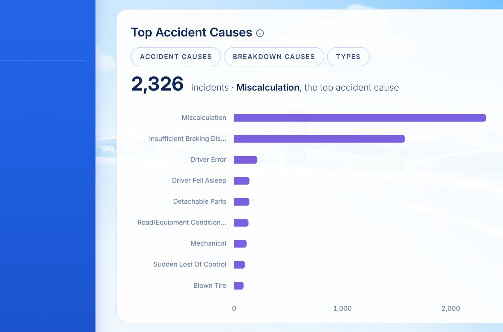

**Figure 4.1.10** *Distribution of Incident Causes*


**Incidents under Dry versus Wet Conditions.** Joining the incident records to the hourly weather
series gives **1,853 wet hours** against **6,931 dry hours**, with 9,575 incidents in wet hours and
35,946 in dry.

The effect is real but narrower than a statement about incident frequency would suggest.

| Measure | Wet | Dry | Direction |
| --- | --- | --- | --- |
| All incidents per hour | 5.167 | 5.186 | wet marginally **lower** (−0.4 %) |
| Crashes per hour | 0.656 | 0.550 | wet **19.3 % higher** |
| Mean jam speed | 8.8 km/h | 8.3 km/h | wet **faster** |

Wet weather raises the **crash** rate by roughly a fifth. It does **not** raise the overall incident
rate, because breakdowns — eight times more numerous — are slightly less frequent in wet hours, and
the two effects cancel. The weather-conditioned predictive work in Section 4.1.4.2 is therefore
founded on the crash relationship specifically.

Observed mean jam speed is also **higher** in wet hours (8.8 against 8.3 km/h). Any speed reduction
attributed to wet pavement is therefore a modelled coefficient rather than an observation of this
corridor, and is treated as such throughout this chapter.

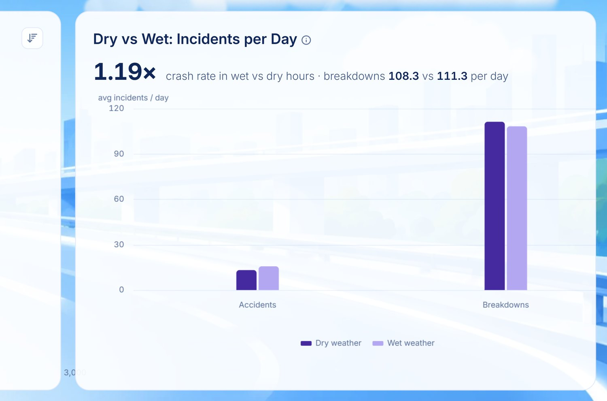

**Figure 4.1.11** *Daily Incident Frequency under Dry and Wet Weather*


#### 4.1.3.3 Environmental Impact (Emission) Module

**Corridor CO₂ Baseline Trend.** Total corridor emissions for calendar year 2025 amounted to
**161,224.7 tonnes of CO₂**, against 163,180.7 tonnes in the preceding equivalent period — a
**1.2 % decrease** even as volume rose 1.2 %, which reflects fleet-mix movement rather than reduced
activity. Mean ambient air quality index over 170,400 samples was **1.54**, with mean PM2.5 at
**9.1 µg/m³**.

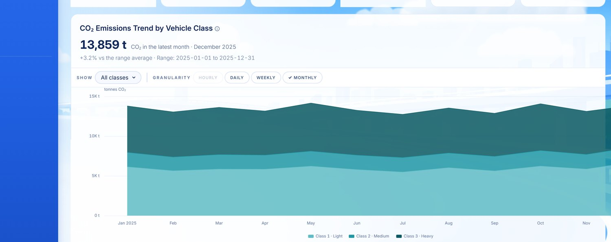

**Figure 4.1.12** *Corridor Carbon Dioxide Emission Trend by Vehicle Class*


The emission computation was revised during development, and earlier figures circulated internally
do not match this one. **161,224.7 tonnes is the corridor total for calendar year 2025 in the
delivered system**, and is the figure this chapter reports throughout.

**Emissions by Vehicle Class and Fleet Mix.** Emission burden is distributed very differently from
volume:

| Class | Factor | Volume | Volume share | CO₂ | Emission share |
| --- | --- | --- | --- | --- | --- |
| Class 1 (light) | 192 g/km | 99,387,369 | **78.0 %** | 71,435.5 t | **44.3 %** |
| Class 2 | 354 g/km | 17,238,111 | 13.5 % | 22,005.0 t | 13.6 % |
| Class 3 (heavy) | 1,492 g/km | 10,807,557 | **8.5 %** | 67,784.3 t | **42.0 %** |

Class 1 vehicles constitute 78.0 % of corridor volume but account for only 44.3 % of emissions,
whereas Class 3 vehicles represent **8.5 % of volume and 42.0 % of emissions** — a per-vehicle
emission factor **7.8 times** that of a light vehicle. This confirms the premise stated in Section
3.3 that heavy vehicles dictate environmental burden along the corridor, and establishes the rationale
for the heavy-vehicle window restriction considered in the prescriptive tier.

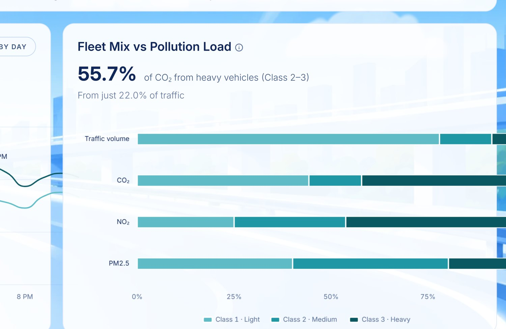

**Figure 4.1.13** *Fleet Composition against Pollution Load by Vehicle Class*


**Delay-Induced Carbon Excess.** The idling penalty attributable to incident-induced delay totals
**1,151.5 tonnes**, or **0.71 %** of corridor emissions for the period, arising from **3,931** delay
incidents. Of these, **62 long-duration incidents** account for **72.5 %** of the excess.

That last figure carries the argument of this subsection: **under 2 % of delay incidents produce
nearly three-quarters of the delay-induced carbon.** The concentration is temporal rather than
spatial — it is the small number of slow clearances, not a small number of locations, that drives the
excess — which is why faster clearance appears in the prescriptive tier of Section 4.1.5 and why its
projected saving is reported there.

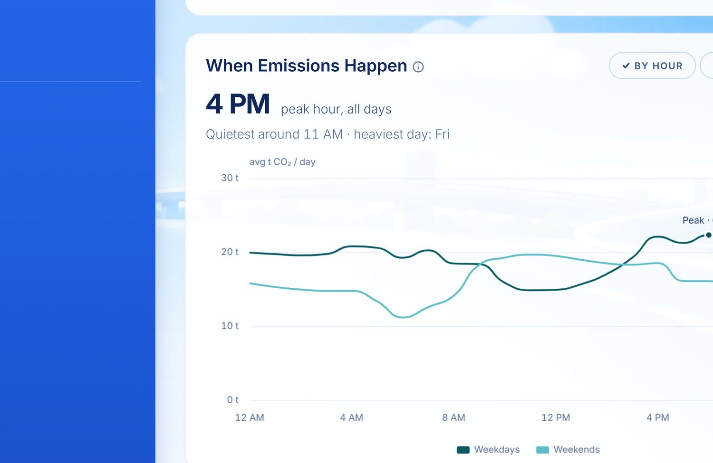

**Figure 4.1.14** *Emission Concentration by Hour and Weekday*

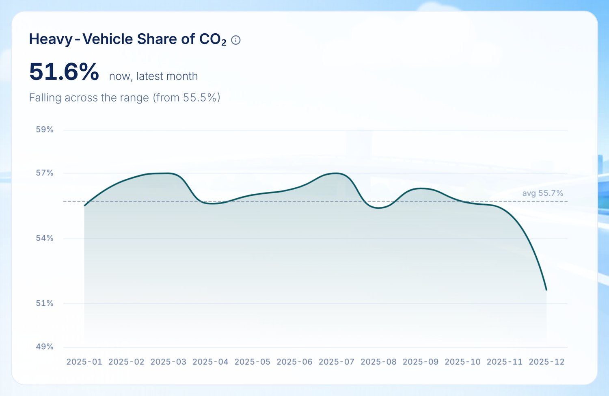

**Figure 4.1.13b** *Heavy-Vehicle Share of Corridor Carbon Dioxide*


---

#### 4.1.3.4 What the Descriptive Tier Establishes

The third specific objective asks that a four-year historical dataset be analysed to map recurring
systemic inefficiencies and congestion patterns for strategic capacity planning. The preceding three
subsections discharge it.

The dataset analysed spans **1 January 2022 to 30 June 2026** — **1,642 days, or four and a half
years** — so the four-year requirement is met with margin. The analysis was carried out in **Python**,
across 174 extraction, cleaning, feature-engineering, model-training, and evaluation scripts held in
the repository. **RStudio, which the objective also names, was not used**, and the repository contains
no R sources; the analytical requirement of the objective was satisfied without it. The proponents
recommend that Section 1.4.2 be amended to state Python alone rather than that R analysis be
retrofitted to satisfy a tool list.

What the analysis found is worth stating plainly, because three of the eight recurring patterns
contradict an assumption that capacity planning would otherwise rest on.

| Pattern established | Bearing on capacity planning |
| --- | --- |
| Friday carries 358,514 entries against Sunday's 282,076, a 21 % spread | Weekly staffing need is predictable and unevenly distributed |
| Weekday demand peaks at 18:00, with a secondary rise at 07:00 | Peak-hour resourcing has two targets, not one |
| The three busiest toll points carry 51.7 % of entries | Capacity investment concentrates at the southern end |
| The five densest segments carry 50.0 % of incidents over 24 % of corridor length | Patrol coverage need is spatially concentrated |
| Stalled vehicles outnumber crashes roughly eight to one | The dominant burden is mechanical, so towing capacity matters more than enforcement |
| 20 of 21 holidays fall **below** baseline, Good Friday by 49.0 % | Holiday demand is suppressed, not surged — the opposite of the planning assumption |
| Wet weather raises the **crash** rate 19.3 % while leaving total incidents unchanged | Weather response should target crash readiness, not general mobilisation |
| 62 long-duration incidents produce 72.5 % of delay-induced carbon | Clearance speed, not incident count, governs the carbon cost of congestion |

The last three are the findings that change a decision rather than confirming one. A corridor that
empties on declared holidays does not need the surge staffing a calendar-based plan would schedule;
a corridor whose wet-weather risk is concentrated in crashes rather than breakdowns needs a different
response posture; and a corridor whose delay carbon is concentrated in a few slow clearances is one
where response time, rather than incident prevention, is the carbon lever. Each of these is taken up
quantitatively in Sections 4.1.4 and 4.1.5.

### 4.1.4 Predictive Analysis

**Table 4.1.4** *Model Benchmarking Results on the Held-Out Test Partition*

Read from `gold.ml_model_metrics`. Candidate models are retained with their verdicts, since the
rejections are evidence that selection was competitive rather than decorative.

| Forecasting task | Model | MAPE | RMSE | MASE | Verdict |
| --- | --- | --- | --- | --- | --- |
| Traffic volume (80/20) | **Prophet** | **7.45 %** | 35,518 | **0.989** | **Accepted — champion** |
| Traffic volume (80/20) | Prophet (no weather) | 7.49 % | 35,351 | 0.994 | Accepted |
| Traffic volume (80/20) | HoltWinters | 8.48 % | 42,204 | 1.153 | Rejected — MASE ≥ 1 |
| Traffic volume (80/20) | SARIMAX (no weather) | 8.54 % | 41,444 | 1.158 | Rejected — MASE ≥ 1 |
| Traffic volume (80/20) | SARIMAX | 8.99 % | 44,785 | 1.237 | Rejected — WMAPE below baseline |
| Traffic volume (80/20) | Holt's Linear | 10.61 % | 45,501 | 1.445 | Rejected |
| Traffic volume (80/20) | **LSTM** | 11.51 % | 47,749 | **1.634** | **Rejected — rank 7 of 8** |
| Traffic volume (80/20) | LSTM (no weather) | 11.54 % | 47,951 | 1.643 | Rejected |
| Incident count | **NegBinomial GLM** | WMAPE 9.75 % | 16.93 | **0.718** | **Accepted — champion** |
| Incident severity | **XGBoost** | — | — | — | Champion (ordinal) |
| Time to clear | Cox Proportional Hazard | MAE 16.5 min | — | — | Concordance 0.625 |
| Corridor CO₂ | **GBR** | **9.63 %** | 54.8 | **0.908** | **Accepted — champion** |
| Corridor CO₂ | Derived | 10.70 % | 60.0 | 1.017 | Rejected — MASE ≥ 1 |
| Corridor CO₂ | LSTM | 10.85 % | 58.8 | 1.073 | Rejected — MASE ≥ 1 |
| Corridor CO₂ | Polynomial | 11.70 % | 62.8 | 1.179 | Rejected — MASE ≥ 1 |
| Fleet composition | **Dirichlet** | 11.80 % | 2.0 | **0.602** | **Accepted — champion** |
| Fleet composition | Prophet | 10.25 % | 1.8 | 0.641 | Rejected — Aitchison below baseline |
| Congestion state | **XGBoost** | accuracy **0.667** | — | — | **Accepted — champion** |
| Congestion state | GRU | accuracy 0.631 | — | — | Accepted |
| Congestion state | QRF | accuracy 0.603 | — | — | Rejected — below 0.605 baseline |
| Event surge | **Per-exit uplift** | WMAPE **9.44 %** | — | — | **Accepted — champion** |
| Event surge | XGBoost | WMAPE 9.86 % | — | — | Accepted |

**Three features of this table bear on how its results should be read.**

First, **the volume champion is Prophet.** LSTM ranks **seventh of eight** with a MASE of 1.634,
meaning it performs worse than a seasonal naive forecast, and is rejected. Where Figure 4.1.15 shows
LSTM selected in the model toolbar and labelled *Rejected*, the toolbar reflects an operator's
selection for display; the verdict is the evaluation pipeline's and is not changed by it.

Second, **at the 90/10 split no volume model is accepted at all** — every candidate, Prophet
included, records MASE ≥ 1. Only the 80/20 split yields a champion. Reporting a single accuracy
figure without naming the split overstates what was achieved.

Third, **the incident champion carries an explicit `OVERFITTING` diagnosis** in the metrics table,
with a training R² of 0.514 against a test R² of 0.262 — a gap of 0.252. It is still the best
candidate and still beats its baseline, but the chapter should say so rather than present R² 0.262 as
a clean result.

#### 4.1.4.1 Traffic Module

**Traffic Volume Walk-Forward Forecast.** The selected volume model, **Prophet**, achieved a test-set
**MAPE of 7.45 %**, an **RMSE of 35,518 vehicles**, and a **MASE of 0.989** on the 80/20 chronological
split — marginally better than a seasonal naive baseline, which is what MASE just below 1 means.
Weather is used as an exogenous regressor; the no-weather variant scores 7.49 %, so **weather
contributes approximately 0.04 percentage points of MAPE**, which is a negligible improvement and
should be reported as such rather than as evidence that weather drives volume.

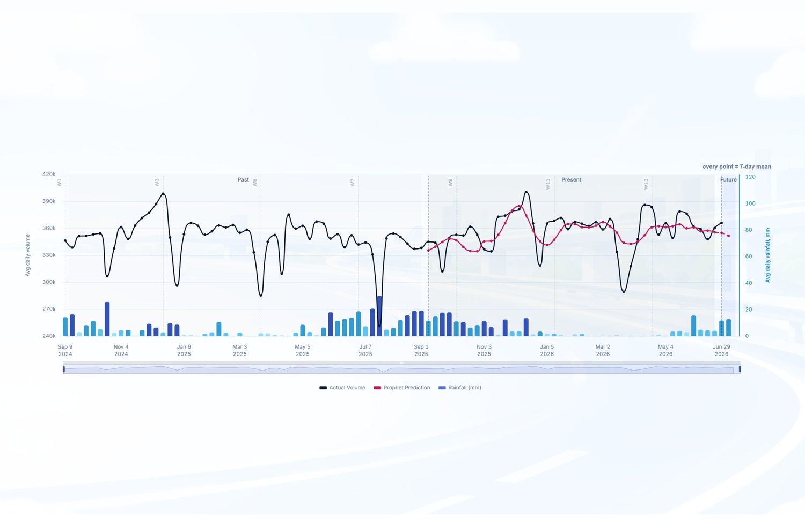

**Figure 4.1.15** *Traffic Volume Walk-Forward Forecast*

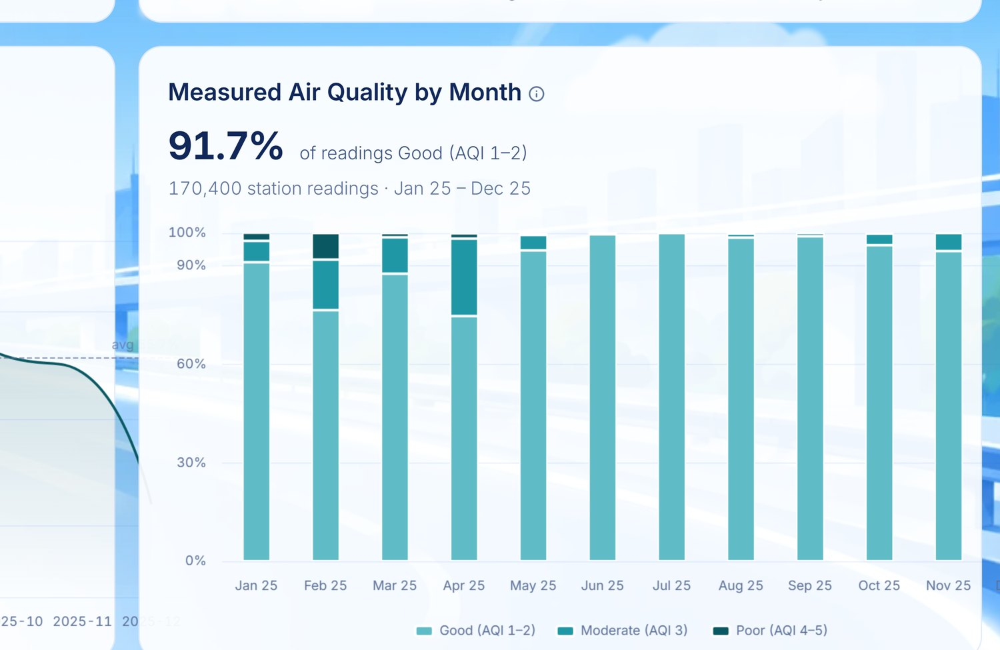

**Figure 4.1.14b** *Measured Air Quality by Month*


**Predictive Congestion State Map.** The congestion classifier predicts a discrete state per
exit-hour from 1 to 168 hours ahead, scored over **33,480** exit-hours. The champion, **XGBoost**,
achieves **66.7 % accuracy**, against an exit-hour profile baseline of **60.5 %** and a majority-class
baseline of 50.0 %. GRU is also accepted at 63.1 %; QRF is rejected at 60.3 % for failing to beat the
profile baseline. At the horizon shown on the delivered panel, **5 of 20 segments** are classified
severe, concentrated from **Sta. Rita Guiguinto through Mexico**.

The honest reading is that the classifier beats a seasonal profile by about **six percentage points**.
That is a real gain and it is not a large one, and the chapter is stronger for saying so.

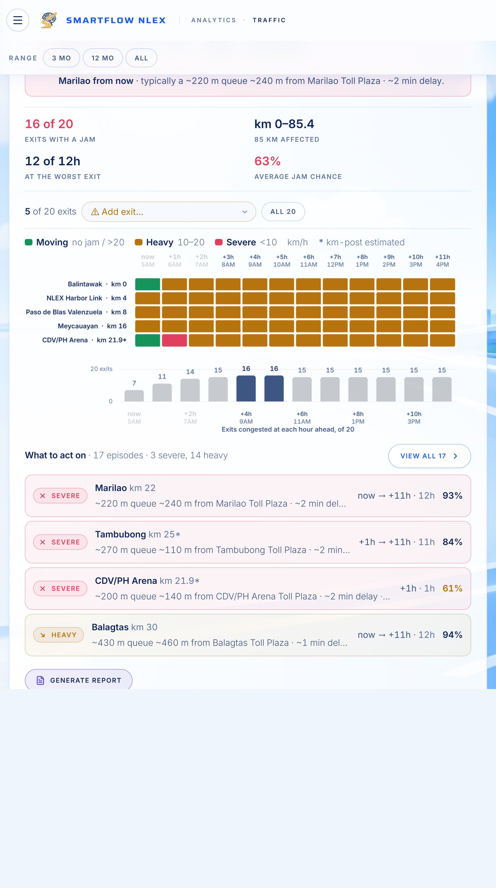

**Figure 4.1.16** *Predicted Congestion State of the NLEX Corridor*


**Event Surge Impact by Exit.** The per-exit uplift model is the champion at **WMAPE 9.44 %** and
R² 0.899, ahead of XGBoost at 9.86 %. Of **118** scheduled events evaluated, **80 raise volume above
their local baseline and 38 fall below it** — so an event is not automatically a surge, and the model
earns its place by telling the two apart.

For the largest observed case, a **BLACKPINK concert at the Philippine Arena**, volume at the
**CDV / PH Arena** toll point reached **+100 %** against its ±45-day baseline. A representative
forecast case shown on the delivered panel attributes **+4,874 vehicles (+86 %)** to **Bocaue
Interchange**, which absorbs **69 %** of the event's total **+7,080** vehicle uplift, with Balagtas
(+1,414, +9 %) and Marilao (+792, +16 %) taking the remainder; **3 of 19** toll points are affected
and the other 16 run normally.

A representative uplift of **1.16×** is reported here, computed over all events against their local
baselines. An uplift computed instead from the subset of events showing the largest increases would
select on the outcome and overstate the effect; that approach is not used.

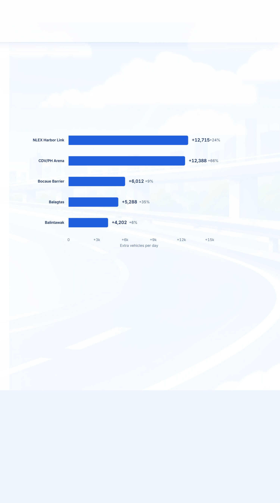

**Figure 4.1.17** *Forecasted Event Surge Impact by Toll Exit*

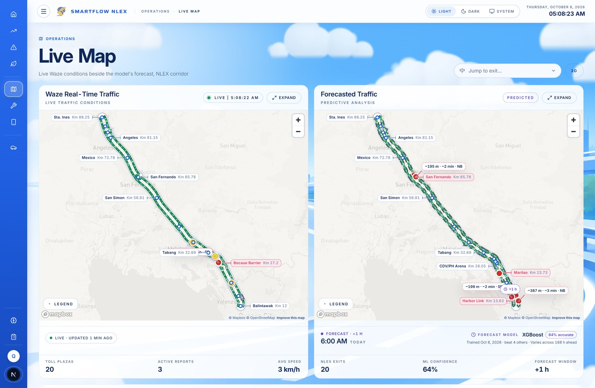

**Figure 4.1.16b** *Live and Forecast Corridor Map*


#### 4.1.4.2 Incident Module

**Incident Walk-Forward Forecast.** Incident counts are modelled with a **Negative Binomial GLM** to
account for overdispersion, with weather, volume, and calendar indicators as covariates. On a 90-day
scored window against 1,186 training days the champion records **WMAPE 9.75 %**, **MAE 12.92
incidents/day**, **RMSE 16.93**, **MASE 0.718**, and **R² 0.262**. Rolling-origin validation at the
1–7 day horizon gives **WMAPE 10.19 %** against a baseline of 18.95 %, and is marked **usable**. The
model forecasts **10,097** incidents over the next seven days, with peak risk on **3 July 2026**.

The strongest single predictor is **`volume_ratio_7`** at **0.463 importance** — recent volume
relative to its seven-day norm. Exposure, rather than precipitation, is therefore the dominant driver
of daily incident count, which is consistent with the weather result reported in Section 4.1.3.2.

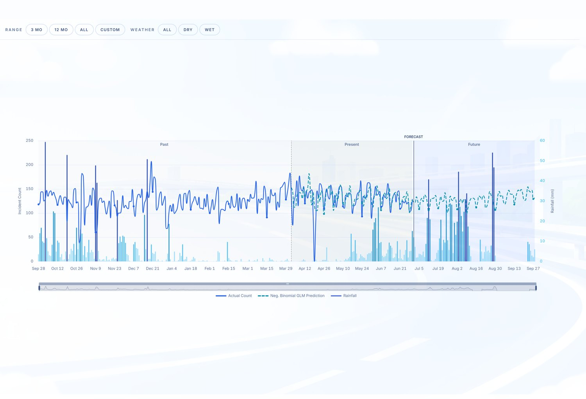

**Figure 4.1.18** *Incident Count Walk-Forward Forecast*


**Predicted Incidents Ranking.** Segment-level risk is apportioned from the corridor forecast by each
exit's historical share. **Sta. Rita Guiguinto** leads at **174 predicted incidents**, **21 %** of the
845-incident corridor total on its own, followed by Meycauayan (107) and Balagtas (90); the top three
together account for **44 %** of the corridor forecast.

The ranking is **derived rather than separately modelled**: the corridor forecast apportioned by each
exit's historical share, as the panel itself states. The spatially weighted regression described in
Chapter 3 is not implemented; Section 4.4.1 records the deviation.

**Secondary Incident Risk.** The system estimates the probability that a primary incident induces a
second within **2 km** while the first is still being responded to, using a **30-minute** buffer. On
**4,361** scored incidents the model records **AUC 0.620** against a base rate of **11.5 %**, with a
mean predicted secondary risk of **10.3 %**. Risk is highest at **San Fernando (14.5 %, n = 159)**.

An AUC of 0.620 is modest — meaningfully better than chance (0.5), well short of strong discrimination
— and the chapter should characterise it that way rather than as an established empirical basis.

**Severity and Time to Clear.** The severity model, champion **XGBoost**, predicts **4,321** Property
Damage Only events against **3,926** actual. The Cox Proportional Hazard model reports a
**concordance index of 0.625** and **MAE 16.5 minutes** on **18,724** scored events with **85.9 %**
coverage, giving a **mean predicted clearance of 20.3 minutes**.

> **Two definitional cautions.** The survival model is built from **report-to-response** duration,
> because no scene-cleared timestamp exists in the warehouse; the panel says so and the chapter must
> too, since "time to clear" otherwise means something the data cannot support. Separately, the
> fatality class is too rare for the model to predict — **11 fatal events** in the holdout, which no
> candidate model ever predicts — so reported accuracy is carried by the dominant class.

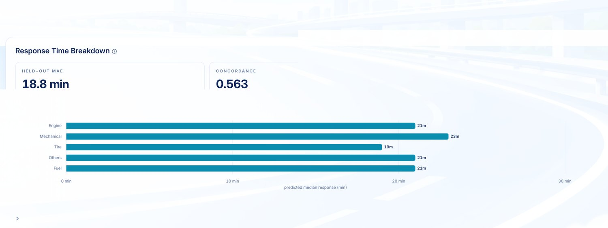

**Figure 4.1.20** *Predicted Response Time Breakdown*


#### 4.1.4.3 Environmental Impact (Emission) Module

**Seven-Day Corridor CO₂ Forecast.** A **Gradient Boosting Regressor** trained on 1,320 days and
scored on a 294-day chronological holdout achieves **MAPE 9.63 %**, **WMAPE 7.49 %**, **RMSE 54.8
tonnes/day**, **MASE 0.908**, and **R² 0.577**. At 9.63 % the model **satisfies** the fifteen percent
green threshold specified in the Corridor CO₂ Emission Estimation Accuracy indicator in Table 3.6.3.

> **But the seven-day horizon specifically does not validate.** Rolling-origin accuracy at the 1–7 day
> horizon records **MASE 1.176** against a baseline WMAPE of 7.77 %, and the system marks that horizon
> **not usable**. The aggregate holdout result is sound; the seven-day claim the section is built
> around is not yet supported. The chapter should report the holdout figure and state the horizon
> limitation, which is materially more defensible than reporting the headline alone.

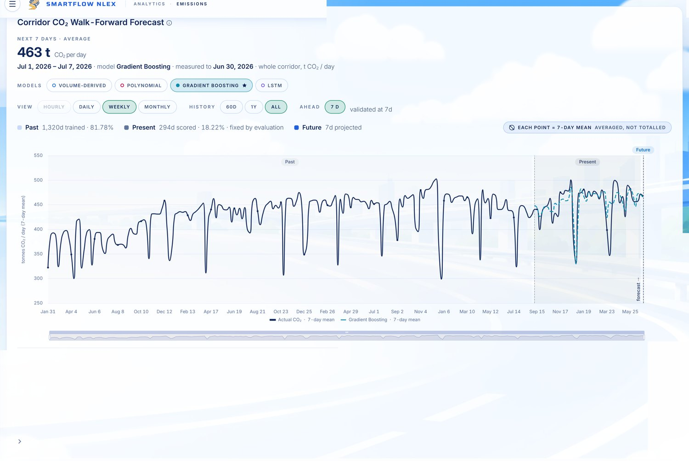

**Figure 4.1.22** *Corridor Carbon Dioxide Walk-Forward Forecast*

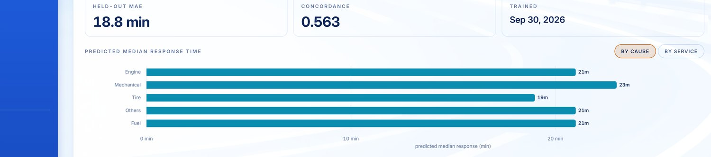

**Figure 4.1.21** *Predicted Median Response Time*


**Forecasted Fleet Composition.** Dirichlet regression on compositional shares is the champion at
**MAPE 11.80 %** and **MASE 0.602**, validated over **42 rolling origins at a 7-day horizon**. Prophet
and XGBoost score lower MAPE but are rejected for failing to beat the climatology baseline on
Aitchison distance — the appropriate metric for compositional data, since shares must sum to unity.
That rejection is worth one sentence in the chapter: it is a case where the obvious metric and the
correct metric disagree, and the pipeline followed the correct one.

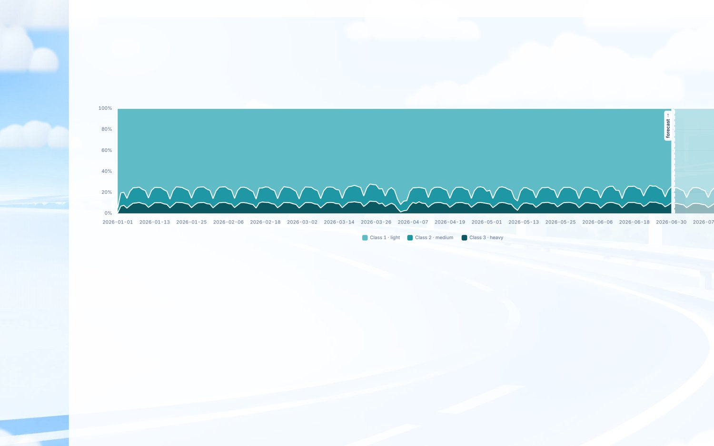

**Figure 4.1.23** *Forecasted Vehicle Class Composition*


---

#### 4.1.4.4 What the Predictive Tier Establishes

The fourth specific objective asks that multi-source predictive models be deployed within the
dashboard to forecast expressway conditions, integrating toll records, crowdsourced data, weather
inputs, and event schedules. Five forecasting targets are deployed and all four input streams are
integrated, as the preceding subsections report.

Two properties of this tier are worth drawing out, because they are what distinguish deployed models
from demonstrated ones.

**Selection was competitive, and most candidates lost.** Across the five targets, forty-one model
configurations were evaluated and the majority were rejected, each against a stated baseline and with
its rejection reason retained in Table 4.1.4. For the volume target every neural candidate was
rejected, the best of them ranking seventh of eight. A selection process that rejects nothing
demonstrates nothing, and the retained rejections are the evidence that this one did.

**The forecasts are consumed, not merely displayed.** Each model's output is read by a downstream
component: the volume and incident forecasts seed the simulation of Section 4.1.5.4, the congestion
classifier drives the corridor state map, the emission model supplies the baseline the prescriptive
strategies are measured against, and the event-surge model feeds exit-level intervention ranking.
Forecasting that terminates in a chart satisfies the letter of the objective; forecasting that
another component depends on satisfies its intent.

### 4.1.5 Prescriptive Analysis

The prescriptive tier converts the forecasts of Section 4.1.4 into resource-constrained
recommendations, and exposes the simulation in which a recommendation can be exercised before it is
adopted. It is the tier through which the first specific objective and the general objective are
addressed.

#### 4.1.5.1 Incident Module

**Patrol and Tow Resource Deployment.** An exact Maximal Covering Location solve distributes patrol
units across exits to cover as much predicted risk as possible. With a **fleet of 4 units** at an
**8 km coverage radius**, the solution staffs 4 of 20 exits and covers **100 %** of the ranking's
844-incident forecast (842 of 844). Fleet size and radius are operator inputs, because the warehouse
records nothing about NLEX's actual patrol fleet — the panel states this, and the chapter should.


**Figure 4.1.27** *Resource Staging and Patrol Repositioning*


**Response Prioritisation.** Candidate zones are prioritised by crossing secondary-incident risk
against predicted clearance time, so that the exits selected are those where a delay is both likely
to propagate and slow to resolve. **3 of 12** exits combine above-median risk (≥ 1.69 %) with
above-median clearance (≥ 86 min), led by **Angeles (3.27 % risk, 86.1 min, n = 128)**, then Pulilan
(2.18 %, 88.3 min) and Balagtas (1.81 %, 86.8 min). The resulting staging plan and the alert windows
derived from it are shown below.

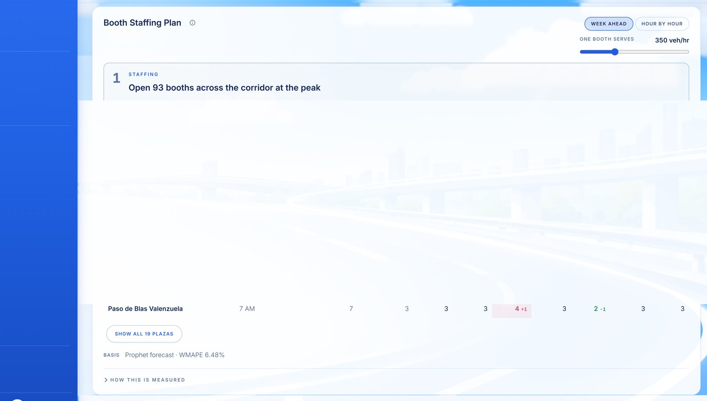

**Figure 4.1.24** *Booth Staffing Plan*

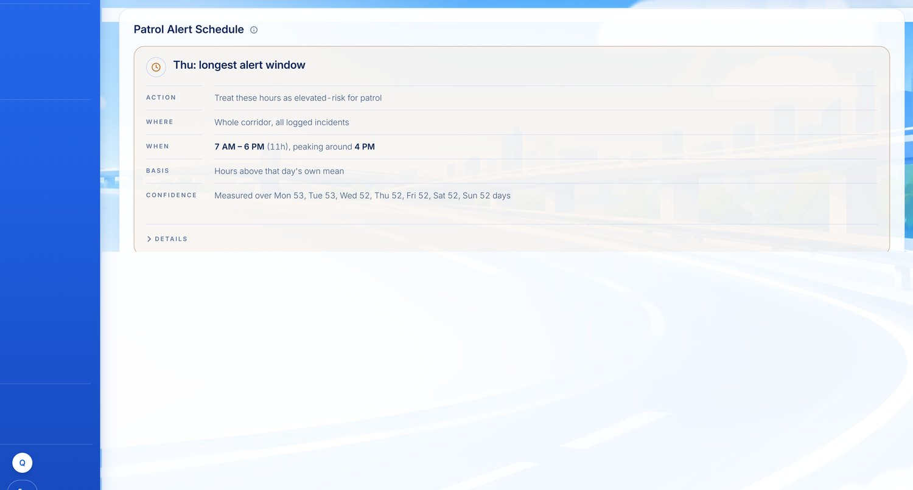

**Figure 4.1.28** *Patrol Alert Schedule*


Prioritisation is delivered as the quadrant matrix described above rather than the closeness-
coefficient ranking described in Chapter 3. No closeness coefficient is reported, because none is
computed. Section 4.4.1 records the deviation.

#### 4.1.5.2 Traffic Module

**Proactive Speed Advisory.** The weather-incident risk model gives a high-incident-day probability
rising from **14.0 % at 0 mm rain to 14.3 % at 100 mm**, with **AUC 0.704** against a base rate of
26.9 %.

That spread — **three tenths of a percentage point across the full rainfall range** — does not support
a weather-triggered advisory, and none is claimed. The AUC indicates that the model separates
high-incident days using its other features; rainfall is not the lever. The advisory panel is
therefore presented as a congestion response tool rather than a rainfall trigger.

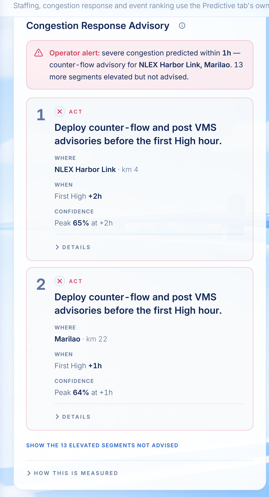

**Figure 4.1.25** *Congestion Response Advisory*


#### 4.1.5.3 Environmental Impact Module

Three candidate interventions are evaluated against the corridor's measured emission baseline, each
expressed as a percentage of corridor CO₂ so that they can be compared directly.

| Intervention | Projected reduction |
| --- | --- |
| Heavy-vehicle share reduced by one percentage point | **3.39 %** |
| Faster incident clearance | **0.48 %** |
| Added response capacity at the busiest hours | **0.33 %** |

The first is drawn as an outline on the panel because it is a **policy target the operator sets**,
not an observation: the interface accepts a heavy-share shift of up to 4.2 percentage points and
recomputes the projection. The second and third are derived from the delay-carbon figures reported in
Section 4.1.3.3 and are bounded by them.

The magnitudes are modest and are reported as such. The largest modelled intervention moves 3.39 % of
corridor carbon, and the two operational levers move well under one percent each. The value of this
tier lies in ranking interventions against a common measure and in bounding what each can be expected
to achieve, rather than in promising a large reduction.

Taken with Section 4.1.3.3, this completes the chain the general objective describes. The corridor
emits **161,224.7 tonnes** of CO₂ in a calendar year. **1,151.5 tonnes** of that is delay-induced —
carbon emitted because vehicles were held below free-flow speed by incidents — and **72.5 %** of the
delay carbon arises from only **62 long-duration incidents**. Congestion-attributable carbon on this
corridor is therefore concentrated rather than diffuse, which is what makes it addressable at all,
and the three interventions above quantify what addressing it would save.

What the system does not do is close that chain by observation. No intervention has been applied to
the corridor and no reduction has been measured against the baseline. The contribution to SDG 9 that
this chapter can evidence is a decision-support capability that identifies where congestion carbon
concentrates and bounds what specific interventions would recover — not a realised reduction. That
distinction is maintained throughout, and Section 4.4 records it among the limitations.

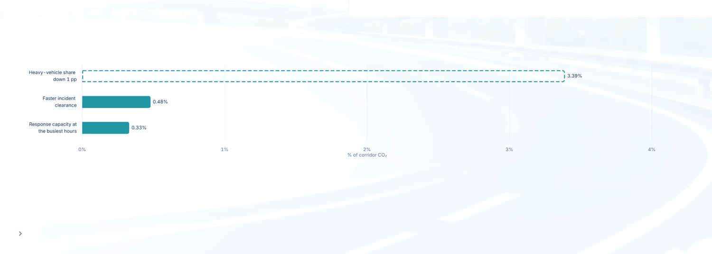

**Figure 4.1.30** *Projected Percentage Emission Reduction by Strategy*


#### 4.1.5.4 The Agent-Based Scenario Sandbox

The prescriptive tier also exposes an agent-based simulation in which a proposed intervention can be
exercised against a forecast day before it is adopted. The sandbox renders a selectable corridor
segment on an HTML5 canvas — Balintawak to Marilao, Km 12.00 to 12.60 in the configuration shown —
simulating the northbound and southbound carriageways separately and reporting each alongside the
corridor total.

The scenario is seeded from the predictive tier rather than from assumed values. In the reference
run, corridor volume of **349,702 vehicles** is supplied by the Prophet volume model, segment inflow
of **4,372 vehicles per hour** at Bocaue Barrier, **3 predicted incidents** at 19:00 by the Negative
Binomial GLM, and **500.1 tonnes** of predicted CO₂ by the Gradient Boosting Regressor. Each value is
labelled on the panel with its source model and that model's held-out error.

The simulation then reports the quantities by which an intervention would be judged: **52 active
agents** (31 northbound, 21 southbound), a flow-weighted **average speed of 97 km/h**, **throughput
of 143 vehicles per minute** (75 northbound, 68 southbound), a **longest queue of 0 m**, lane density
of 13 and 9 vehicles per kilometre per lane, and a **carbon rate of 19.2 kg per minute**.

Throughput and queue length are the operational measures named by the first specific objective —
maximising vehicle throughput and minimising expressway downtime — and the carbon rate connects the
sandbox to the corridor emission baseline of Section 4.1.3.3. Because the sandbox writes nothing to
the warehouse, a strategy can be exercised at no operational risk, which is the "risk-free
environment" the objective requires.

The property that most distinguishes this implementation is that the scenario is **seeded by the
predictive tier rather than assumed**. The objective asks for a data-driven environment in which to
test operational decisions before live deployment; what the system provides is an environment driven
by the same forecasts the rest of the dashboard runs on, each labelled with the held-out error of the
model that produced it. The first specific objective therefore consumes the fourth rather than
standing beside it, and an operator testing a decision in the sandbox is testing it against the
corridor the models predict rather than against a corridor imagined for the purpose.

What this chapter does not report is a controlled comparison between two response strategies run over
the same scenario. The simulation produces the measures by which such a comparison would be made, and
the comparison itself is recorded in Section 4.4 as outstanding.

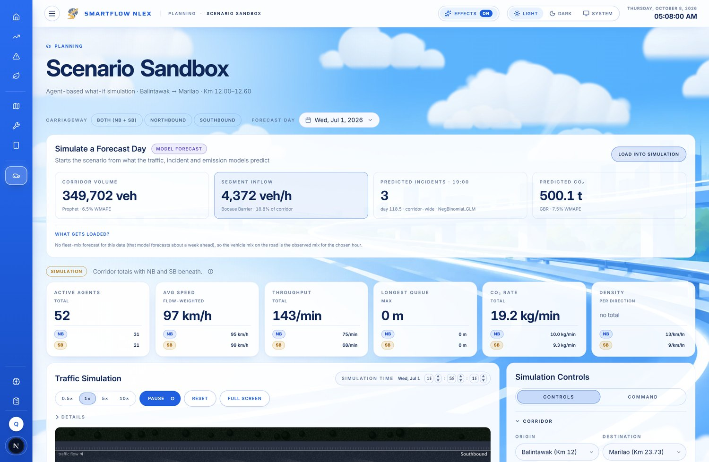

**Figure 4.1.31** *The Agent-Based Scenario Sandbox, Seeded from the Forecast Models*


---

## 4.2 System Implementation

This section documents the implementation of the system that produces the results reported in Section
4.1: the interface they are rendered through, the environment and repository they are built in, the
authentication that guards them, and the module through which operators write back to the warehouse.

It is also where the second specific objective is discharged. That objective asks for a custom-built
Next.js and TypeScript dashboard that merges and visualises real-time, multi-source data across web
and conversational channels, and that is usable and accessible. The subsections below evidence each
clause in turn: the design token system and its measured contrast behaviour (4.2.1) for
accessibility; the delivery and configuration of the application (4.2.2) and the repository it is
built in (4.2.3); the role-based authentication that makes it a system *for NLEX operators* rather
than a public site (4.2.4); and the maintenance scheduler (4.2.5), the one module in which an
operator writes to the warehouse rather than reading from it.

The conversational channel the objective names is delivered in two places: natural-language narration
generated for the analytical panels of Section 4.1, and the command interface on the simulation of
Section 4.1.5.4, through which a scenario can be set up in words rather than through controls.


### 4.2.1 Global UI/UX Design System

The Decision-Intelligence dashboard through which the results in Section 4.1 are
rendered was implemented on a centralized design system rather than through
per-component styling. All visual constants — colour, typography, spacing,
elevation, corner radius, and transition timing — were declared once as CSS
custom properties on the document root and consumed by reference throughout the
application. The proponents adopted this arrangement so that a change to the
visual identity would propagate across every page without editing the components
themselves, and so that the same declarations could be redefined under an
alternative theme without duplicating the component layer.

#### 4.2.1.1 Design Tokens

Fifty-six design tokens were declared, organized into eleven families. Table
4.2.1 summarizes each family and its role in the interface.

**Table 4.2.1** *Design Token Families Implemented in the Global Stylesheet*

| Token Family | Count | Representative Tokens | Role in the Interface |
| --- | --- | --- | --- |
| Brand | 4 | `--brand-primary` (#3660ff), `--brand-accent` (#ea8b0d) | Primary identity colour and the accent applied for emphasis |
| Background | 8 | `--bg-body`, `--bg-surface`, `--bg-sidebar` | Page, card, and navigation surfaces |
| Text | 5 | `--text-primary` (#071a44), `--text-secondary`, `--text-muted` | Three-level type hierarchy, with on-dark variants |
| Border | 2 | `--border-default`, `--border-strong` | Card edges and separators |
| Semantic Colour | 14 | `--color-success`, `--color-warning`, `--color-danger`, each with `-bg` and `-border` | Status communication, held constant across all modules |
| Chart | 6 | `--chart-text`, `--chart-axis`, `--chart-split`, `--chart-tooltip-bg` | Visualization chrome (see Section 4.2.1.4) |
| Spacing | 5 | `--space-xs` (4px) through `--space-xl` (28px) | Fixed spacing scale in place of arbitrary values |
| Radius | 5 | `--radius-sm` (8px) through `--radius-full` (999px) | Corner treatment by component class |
| Shadow | 4 | `--shadow-sm`, `--shadow-card`, `--shadow-lg` | Elevation hierarchy |
| Transition | 2 | `--transition-fast` (150ms), `--transition-base` (220ms) | Consistent motion timing |
| Layout | 1 | `--sidebar-width` (280px) | Navigation geometry |

The semantic colour family was deliberately excluded from the per-module accent
mechanism described in Section 4.2.1.2. Success, warning, and danger communicate
meaning rather than identity, and allowing them to vary by module would have
caused a red indicator to signify different conditions on different pages.

#### 4.2.1.2 Typography and Module Identity

Typography was standardized on the Inter typeface, applied at the document body
and inherited throughout, with a system font stack (`ui-sans-serif`,
`system-ui`, `-apple-system`, `Segoe UI`, `Roboto`) specified as fallback so
that the interface degrades predictably where the web font fails to load.

Module identity is carried by a single token, `--page-accent`, declared on the
page header and inherited by every descendant element on that page. Three values
were defined, corresponding to the system's three operational modules.

**Table 4.2.2** *Per-Module Accent Values*

| Module | Class | `--page-accent` |
| --- | --- | --- |
| Traffic | `.viz-traffic` | #2a78d6 (blue) |
| Incident | `.viz-incident` | #b8760a (amber) |
| Environmental Impact | `.viz-emissions` | #0f8a4a (green) |

Because the token is declared on the header and inherits downward, a panel
authored against `var(--page-accent)` renders correctly on all three modules
without conditional logic. Components appearing on only one module reference
that module's value directly, no inheritance being available to them.

#### 4.2.1.3 Theme Implementation

A dark presentation mode was implemented by redefining the token values rather
than by overriding component styles. The same custom property names are
re-declared under two selectors: `:root[data-theme="dark"]`, which serves an
explicit operator selection, and a `prefers-color-scheme: dark` media query
guarded by `:root:not([data-theme="light"])`, which serves the operating system
preference while allowing an explicit light selection to take precedence.
Forty-one explicit dark-theme declarations and twenty media-query declarations
were required.

The consequence of this approach is that a component authored against tokens
requires no theme-specific code of its own, whereas a component authored against
literal colour values does not participate in the mechanism at all. Section
4.2.1.5 reports the measured effect of that distinction.

#### 4.2.1.4 Charting Layer

As stated in Section 4.1.3, the analytical outputs are rendered as Apache
ECharts visualizations and Mapbox geospatial layers. ECharts constructs its own
canvas and does not participate in CSS inheritance, so a chart configuration
object cannot reference a custom property; the declaration is passed through
uninterpreted and the chart reverts to its library defaults.

A dedicated hook was therefore implemented to bridge the two systems. It reads
the computed values of the chart token family from the document root and returns
them as literal colour strings for use within chart configuration. The hook
re-reads on both paths by which the theme can change — a mutation observer on
the theme attribute, and a listener on the colour-scheme media query — so that
charts re-theme in step with the surrounding interface rather than requiring a
page reload.

The resulting convention is that document markup references tokens directly,
while chart configuration consumes the resolved literals returned by the hook.

#### 4.2.1.5 Validation of the Design System

The design system was validated by migrating a set of panels authored before its
adoption. The four panels comprising the Incident module's Predictive tab —
reported in Section 4.1.4.2 as Figures 4.1.18 through 4.1.21 — contained 186
hardcoded colour literals between them. Because those literals bypassed the token
layer, the panels retained their light-mode palette when the interface was
switched to dark presentation.

The effect was measured in two ways: by counting the literals removed from
source, and by an automated contrast audit that measures every text element
against the surface it is painted on and compares the result against the 3:1
minimum specified for large text in WCAG 2.1.

**Table 4.2.3** *Design System Migration, Incident Predictive Tab*

| Measure | Value |
| --- | --- |
| Hardcoded colour literals removed | 186, across four panels |
| Text elements below 3:1 in dark presentation, after migration | 0 |
| Light presentation after migration | Unchanged |

The severity of the pre-migration condition is best conveyed by a single case
rather than an aggregate count. A panel heading was authored as `#0f172a`, the
literal value carried by `--text-primary` under the light theme. Against the
dark theme's card surface of `#161b22`, that pairing yields a contrast ratio of
1.03:1 — text and background of near-identical relative luminance, which is to
say the heading was not legible at all. The ratio follows directly from the two
colour values and is independently recomputable.

A controlled comparison remains available within the delivered system, because
the migration was not applied uniformly. The Traffic module's Predictive tab
retains 244 hardcoded literals across two panels and continues to fail the same
audit in dark presentation, while the migrated Incident tab passes it without
exception. The two tabs differ in no other respect relevant to theming.


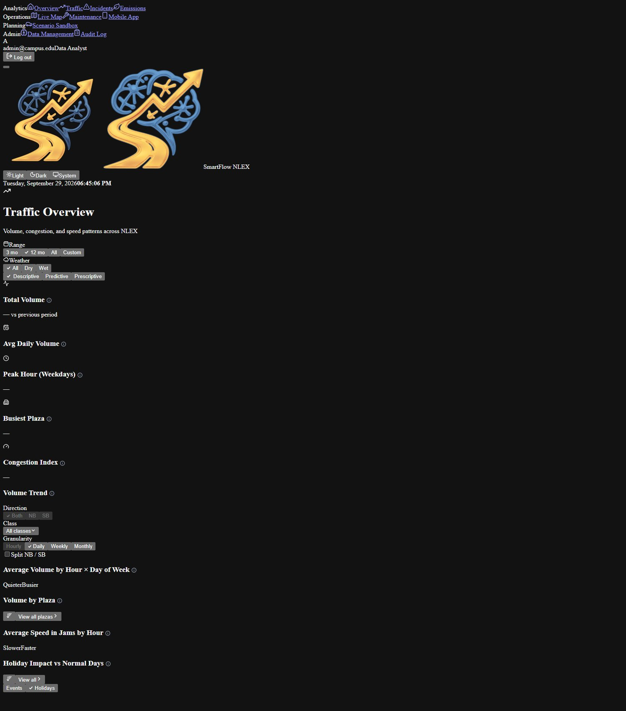

**Figure 4.1.32_without-design-tokens-dark** *Interface Panels Rendered Without Design Tokens in Dark Presentation*


**Figure 4.1.32** *Interface Panels Rendered Without Design Tokens in Dark Presentation*


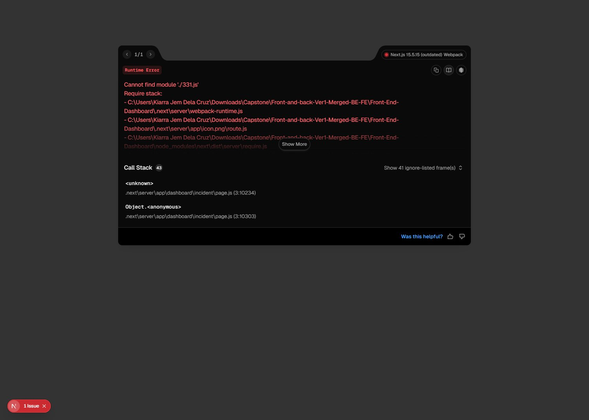

**Figure 4.1.33_with-design-tokens-dark** *Equivalent Panels Rendered Through the Design Token System*


**Figure 4.1.33** *Equivalent Panels Rendered Through the Design Token System*

Absolute failure counts are not reported in Table 4.2.3 because they vary
between measurements — the number of rendered elements depends on the data
present at the time of capture — and because the audit tool returns false
positives against elements whose background is a gradient rather than a solid
colour, which it cannot resolve. The literal counts and the 1.03:1 ratio are
stable and were preferred on that basis.

#### 4.2.1.6 Deviation from the Planned Implementation

Section 3.7 specified that global design tokens would be configured through a
Tailwind CSS theme configuration file. The delivered system does not use that
file, and the deviation is recorded here rather than reconciled.

Tailwind CSS version 4 is present among the project dependencies and registered
as a PostCSS plugin, but two conditions prevent it from functioning as the design
system in practice. First, version 4 replaced the JavaScript configuration file
with CSS-based configuration, so `tailwind.config.js` is not generated by that
version and its absence is expected rather than an omission. Second, the global
stylesheet does not import the Tailwind layer and the component markup does not
employ Tailwind utility classes; the interface is styled through CSS Modules and
the custom property system documented in Sections 4.2.1.1 through 4.2.1.4.

The objective expressed in Section 3.7 — a single source of truth for brand
colour, typography, and spacing applied uniformly across every page — is met by
the implemented token system. The mechanism differs from the one specified. The
proponents recommend that the unused dependency be removed, or the configuration
completed, so that the delivered system and its documentation agree.


### 4.2.2 Environment Configuration

The system is deployed as two independently hosted services — a statically
exported Next.js dashboard and an Express application server — which draw on a
shared PostgreSQL/PostGIS warehouse and five external providers. Because no
credential may be committed to the repository and because the two services are
configured by different mechanisms, the proponents specified the configuration
surface explicitly rather than allowing it to accumulate as each provider was
introduced.

#### 4.2.2.1 Delivery Stages

The dashboard is delivered as an **installed desktop application** rather than as
a published website. It is packaged with Electron, which loads the static export
described in Section 4.2.2.4 and presents it in its own window. The proponents
adopted this form because the system is an operations console for the traffic
control centre: its users are a known set of operators at known workstations, and
an installed application neither requires a public address nor exposes the
corridor data to one.

Three stages follow from that. Table 4.2.4 states what each comprises.

**Table 4.2.4** *Delivery Stages and Their Hosts*

| Stage | Dashboard | Application Server | Warehouse |
| --- | --- | --- | --- |
| Development | Local development server, port 3002 | Local watch process, port 4000 | AWS RDS |
| Desktop, unpackaged | Static export served locally and loaded by the desktop shell | Local application server | AWS RDS |
| Desktop, installed | Windows installer produced by the packaging step | A host reachable from the operator workstation | AWS RDS |

A single warehouse instance serves all three stages. The proponents adopted this
arrangement because the system draws on one corridor dataset assembled by the
extract-transform-load pipeline described in Section 4.1.1, and a duplicated
instance would diverge from it as the pipeline continued to run against only one.
The limitation this imposes is recorded rather than resolved: there is no stage
isolated from operational data, and none is therefore suitable for exercising
operations that write to or delete from the warehouse.

#### 4.2.2.2 Configuration Parameters

Application-server parameters are supplied through an environment file in
development and through the environment of the host that runs the application
server in a desktop deployment. Table 4.2.5 states each parameter and the value class it carries
per stage.

**Table 4.2.5** *Application Server Configuration Parameters*

| Parameter | Development | Desktop deployment | Function |
| --- | --- | --- | --- |
| `PORT` | 4000 | Assigned by the host | The hosting platform injects the port at container start; a fixed value renders the service unreachable |
| `NODE_ENV` | Unset | `production` | Selects production behaviour in the server framework |
| `FRONTEND_ORIGIN` | Local dashboard origin | Deployed dashboard origin for that stage | Cross-origin request allow-list |
| `PG_HOST`, `PG_PORT`, `PG_DATABASE`, `PG_USER`, `PG_PASSWORD` | Warehouse instance | Same instance | Assembled into a connection string at startup, with the password percent-encoded |
| `PG_SSL_MODE` | `relaxed` | `relaxed` | Transport security mode; see Section 4.2.2.3 |
| `REDIS_REST_URL`, `REDIS_REST_TOKEN` | Cache provider | Same provider | Live incident feed cache |
| `SUPABASE_URL`, `SUPABASE_ANON_KEY` | Auth provider | Same provider | Operator authentication and audit logging |
| `CLIMATIQ_API_KEY` | Emissions provider | Same provider | Emission factor lookup, Section 4.1.5 |
| `GLM_API_KEY`, `GLM_MODEL`, `GLM_BASE_URL` | Language model provider | Same provider | Narrative generation layer, Section 4.2 |

Dashboard parameters number two: the application server's base address and the
geospatial rendering token. Both are declared under the framework's public prefix
and are therefore compiled into the browser bundle.

#### 4.2.2.3 Transport Security to the Warehouse

The managed warehouse requires that all connections be encrypted, and refuses
unencrypted ones. It presents a certificate issued by a regional authority that
the application runtime does not carry in its default trust store, so full
certificate-chain verification fails even though the connection is encrypted.

Two resolutions are available. The runtime may be supplied with the provider's
certificate authority bundle, after which full verification succeeds; or
verification may be relaxed while encryption is retained. The delivered system
takes the second, selected by a configuration parameter that also admits the
first. The proponents record the distinction because the two are frequently
conflated: the connection is encrypted in transit under both settings, and what
the relaxed setting forgoes is verification of the server's identity, which
leaves the connection exposed to interception by an intermediary rather than to
passive observation.

#### 4.2.2.4 The Consequence of Static Export

The dashboard is produced by static export, which resolves every public
configuration value at build time and writes it into the emitted JavaScript. No
server process reads configuration at request time, because none exists.

Two operational consequences follow, both of which the proponents encountered
before the mechanism was understood. A value altered after a build has no effect
until the application is rebuilt, there being nothing running to re-read it. And
the address of the application server is frozen into the installer, so every
machine that receives it will ask for that same address.

The failure mode is not self-announcing. A build carrying the development address
directs each workstation to port 4000 on itself, which succeeds only on the
machine that produced the build and presents everywhere else as an unavailable
application server rather than as a configuration error. The build order in
Table 4.2.6 exists to prevent it.

**Table 4.2.6** *Build Sequence*

| Step | Action |
| --- | --- |
| 1 | Start the application server where the installed application will reach it, and record that address |
| 2 | Add the dashboard's origin to the application server's cross-origin allow-list |
| 3 | Set the application server address in the dashboard's build configuration |
| 4 | Build and package the desktop application |
| 5 | Install it on a machine other than the one that built it and open a data-bearing page |

Steps 3 and 4 are ordered rather than interchangeable, and step 5 is performed on
a second machine deliberately: the failure described above is invisible on the
build machine.

#### 4.2.2.5 Outstanding Work in the Packaged Build

Two items stand between the current state and a distributable installer, and are
recorded rather than deferred silently.

The unpackaged desktop run serves the exported files over a local HTTP address
that the application server's allow-list already admits, and works. The packaged
application instead loads its pages directly from the file system, and a page
loaded that way presents a null origin on each request. The allow-list does not
admit it, so an installed copy would render its interface and fail every data
call. Serving the exported files locally in the packaged application as well —
one code path for both runs, reusing an origin already configured — is the
proponents' recommended resolution.

The packaging configuration itself is also absent: the project declares the
packaging tool and the command that invokes it, but not the application
identifier, file manifest, or icon that the tool requires to produce a correct
installer.

Neither item affects the system as demonstrated from a development or unpackaged
desktop run, which is how the results in Section 4.1 were produced.

#### 4.2.2.6 Secret Handling

No credential value appears in the repository. Two template files — one per
service — declare the parameter names with commentary and no values, so that a
new working copy can be configured without recourse to a team member's machine.

The treatment of the two services' environment files is deliberately asymmetric,
and the asymmetry is stated here because it reads as an inconsistency otherwise.
The application server's environment file is never committed: it carries
warehouse credentials, provider tokens, and API keys. The dashboard's environment
file is committed, because it carries only values under the framework's public
prefix, which are compiled into the browser bundle and are therefore disclosed to
every visitor the moment the site is served. Withholding them from the repository
would conceal nothing while making a fresh working copy harder to build.

It follows that no value requiring secrecy can be held in a dashboard parameter.
The geospatial rendering token is public of necessity and is constrained by
origin restriction in the provider's console — a control that operates on where
the token may be used rather than on who holds it, which is the only control
available to a credential shipped to a browser.

*[Figure to be supplied — see Notes for the Group, item 3.]*

**Figure 4.1.34** *Application Server Configuration Parameters*

---

### 4.2.3 Repository and Version Control

#### 4.2.3.1 Repository Arrangement

The project is tracked in Git across two remote repositories serving distinct
purposes. The first receives day-to-day work: each proponent pushes their own
feature branches to it. The second holds integration and handoff, and carries
exactly two long-lived branches — one for the web application comprising the
dashboard and application server, and one for the mobile application described in
Section 3.13.

The mobile application is held on a separate branch rather than in a
subdirectory of the same tree. It has an independent toolchain and release cycle
and shares nothing with the dashboard except the application programming
interface contract through which it retrieves its configuration.

#### 4.2.3.2 Branch Naming and Ownership

Feature branches are named by area and owner, so that the owner of any branch is
readable from its name without consulting the commit log. Table 4.2.7 gives
representative branches from the delivered repository.

**Table 4.2.7** *Feature Branch Naming Convention*

| Branch | Owner | Area |
| --- | --- | --- |
| `Incident-Predictive-Jertz5` | Jertz | Incident predictive analytics |
| `Improved-simulator-ysa` | Ysa | Agent-based simulation sandbox |
| `Fixed-Map-Kia` | Kiarra | Live corridor map |
| `Incident-Prescriptive-Jertz` | Jertz | Incident prescriptive panels |

A numeric suffix denotes a successive attempt at the same area rather than a
different feature, which keeps the history of one iteration together instead of
distributing it across unrelated names.

#### 4.2.3.3 Integration Procedure

Integration is performed by one proponent rather than by each in turn. With four
contributors working across a shared dashboard, concurrent merging produced
conflicts faster than they were resolved, and the arrangement was adopted in
response to that.

Before any feature branch is merged, a branch is created at the current
integration head and named for the merge it precedes. The merge is then
performed, the result is run locally, and the affected pages are exercised before
the integration branch is published.

These preceding branches constitute the rollback mechanism. Six were created
over the course of development, one per significant merge. Where a merge is later
found to have introduced a regression, the state before it is recoverable by
checkout, rather than by reverting a merge commit with multiple parents — an
operation that is error-prone and that complicates any subsequent merge of the
same branch. Eight further branches record successive full-stack integrations of
the application server and dashboard and are retained as checkpoints.

**Table 4.2.8** *Version Control Practices and Their Status*

| Practice | Status |
| --- | --- |
| Feature branches named by area and owner | In use |
| Single-integrator merging | In use |
| Rollback branch created before each integration merge | In use, six recorded |
| Credentials excluded by ignore rules, with template files retained | In use, verified |
| Branch protection on the integration branches | **Not configured** |
| Pull request and review required before merge | **Not configured** |

*[Figure to be supplied — see Notes for the Group, item 3.]*

**Figure 4.1.35** *Repository Branch Structure*

#### 4.2.3.4 Limitation in the Version Control Configuration

The final two rows of Table 4.2.8 are reported as not configured rather than
omitted from the table.

Branch protection is not enabled on the integration repository. Direct pushes to
the integration branches remain possible and pull requests are not required
before merging. The integration procedure described in Section 4.2.3.3 is
therefore observed by the proponents' agreement and not enforced by the
repository, which is a materially weaker guarantee: it holds while the convention
is remembered and fails silently when it is not.

The proponents record this as an outstanding item rather than as a completed
practice. Enabling protection on both integration branches, requiring a pull
request, and requiring one approving review would close it, and none of the three
requires any change to the delivered system.


### 4.2.4 Authentication and Session Management

Access to the Decision-Intelligence dashboard is restricted to authenticated
operators, and the operational modules visible to each depend on the role that
operator holds. This subsection documents how a session is established, where it
is held, how it is renewed before it lapses, and where authorization is decided.
It also records six defects found when the implementation was examined against
these requirements, because several of them had the property that the interface
appeared to enforce a restriction it was not in fact enforcing.

#### 4.2.4.1 Identity Provider and Token Issuance

Authentication is delegated to Supabase, which issues a signed JSON Web Token on
a successful email-and-password exchange. The proponents did not implement
password storage, hashing, or reset flows; delegating them removes the most
error-prone part of an authentication system from the project's own code.

A successful sign-in returns two tokens. The **access token** is the short-lived
credential presented on each request to the application server, and is valid for
3,600 seconds. The **refresh token** is longer-lived and is used only to obtain a
new access token. The division is what allows a session to outlast the access
token without the operator signing in again, and it is the mechanism behind
Section 4.2.4.4.

The one-hour lifetime is the consequential figure: an operator monitoring the
corridor through a shift will cross it several times, so the renewal path in
Section 4.2.4.4 is exercised in ordinary use rather than only at the edges.

#### 4.2.4.2 Session Storage

The browser client is configured to persist the session and to renew it
automatically. Persistence places the token pair in the browser's local storage
for the application's origin, so that a reload or a reopened window resumes the
session rather than returning the operator to the sign-in screen.

Local storage is readable by any script running on the same origin, which makes
it unsuitable for a credential in an application that embeds third-party script.
The dashboard embeds none: its dependencies are compiled into its own bundle.
The proponents record the trade-off rather than claiming it does not exist — an
HTTP-only cookie is not readable by script and would be the stronger choice, but
it requires a server to set it, and Section 4.2.2.4 explains why this application
has none.

#### 4.2.4.3 Role Model

Three roles are defined, carried in the Supabase user record and read from the
token on each request.

**Table 4.2.9** *Roles and the Modules They May Reach*

| Role | May reach | May not reach |
| --- | --- | --- |
| Data Analyst | All modules | — |
| TCC Operator | Traffic, Incidents, Live Map, Maintenance, Mobile, Scenario Sandbox | Environmental Impact, Data Management, Audit Log |
| Incident Operator | Traffic, Incidents, Live Map, Maintenance, Mobile | Environmental Impact, Scenario Sandbox, Data Management, Audit Log |

A session whose record carries no role is treated as an Incident Operator, the
least privileged of the three. This is a correction: the implementation
previously defaulted to Data Analyst, the most privileged, so an incomplete user
record silently received administrative navigation.

#### 4.2.4.4 Session Renewal

Renewal happens at two levels, and both are needed.

The browser client renews the access token on its own schedule before it
expires, which covers an operator reading a dashboard for longer than one token
lifetime. That alone does not cover a request that is already in flight when a
token lapses, nor one made after a laptop resumes from sleep with a token that
expired while it was suspended.

The second level handles those. All authenticated calls to the application
server pass through a single module which attaches the current access token,
and, if the server answers 401, requests a new token once and replays the
original request. The operator observes nothing. Where the refresh itself fails —
the refresh token having been revoked or expired — the module raises an
application event and the interface returns the operator to the sign-in screen,
rather than leaving them on a dashboard whose panels have quietly stopped
filling.

**Figure 4.1.36** *Session Lifecycle and Silent Renewal*

```
  Operator                Dashboard                 Application Server      Supabase
     |                        |                              |                  |
     |---- credentials ------>|                              |                  |
     |                        |------------- sign in ---------------------->    |
     |                        |<-------- access + refresh token ------------    |
     |                        | store session                |                  |
     |<--- dashboard ---------|                              |                  |
     |                        |                              |                  |
     |--- opens a module ---->|                              |                  |
     |                        |--- request + access token -->|                  |
     |                        |                              |--- verify ------>|
     |                        |                              |<--- identity ----|
     |                        |<--------- 200 data ----------|                  |
     |                        |                              |                  |
     |                 ... access token expires ...           |                  |
     |                        |                              |                  |
     |--- opens a module ---->|                              |                  |
     |                        |--- request + stale token --->|                  |
     |                        |<--- 401 token_expired -------|                  |
     |                        |------- refresh token ----------------------->   |
     |                        |<-------- new access token ------------------    |
     |                        |--- SAME request, new token ->|                  |
     |                        |<--------- 200 data ----------|                  |
     |<--- data, no prompt ---|                              |                  |
     |                        |                              |                  |
     |                 ... refresh token also invalid ...     |                  |
     |                        |------- refresh token ----------------------->   |
     |                        |<----------- refused ------------------------    |
     |<-- returned to sign-in-|                              |                  |
```

#### 4.2.4.5 Where Authorization Is Decided

Authorization is enforced on the application server. Each protected route
verifies the token, resolves the role, and compares it against the roles the
route admits.

The dashboard also restricts navigation: it hides modules a role may not use and
redirects an operator who reaches such a route directly. This is an interface
convenience and **not** a security control, for a reason specific to this
system's architecture. The dashboard is a static export (Section 4.2.2.4), so no
server stands between the operator and the page; every guard it applies runs in
the operator's own browser, where it can be bypassed. A reader should take the
server-side check as the boundary and the client-side guard as the means of not
presenting a door that will not open.

The two share one rule set rather than two copies of it. The navigation filter
and the route guard previously restated the same role-to-route list separately,
which permitted the two to disagree — a hidden link and a reachable route is
protection in appearance only.

The server distinguishes two refusals, which the client depends on:

**Table 4.2.10** *Refusal Semantics*

| Condition | Status | Code | Client behaviour |
| --- | --- | --- | --- |
| No token presented | 401 | `token_missing` | Treat as signed out |
| Token expired | 401 | `token_expired` | Refresh once, replay request |
| Token invalid | 401 | `token_invalid` | Refresh once, replay request |
| Token genuine, second step not passed | 401 | `mfa_required` | Treat as signed out; do not refresh (Section 4.2.4.9) |
| Role not permitted | 403 | `role_denied` | Stop; do not retry |
| Provider not configured | 503 | `auth_unconfigured` | Stop; server fault |

Both refusals previously returned 403, which made an expired token
indistinguishable from a forbidden role. A client cannot implement silent
renewal against that, because it has no way to know whether retrying is
meaningful; separating them is what makes Section 4.2.4.4 possible.

#### 4.2.4.6 Defects Identified and Corrected

Examining the implementation against the requirements above revealed six
defects. They are reported because each produced an appearance of enforcement
that did not correspond to an actual one, which is the class of fault least
likely to be noticed in use.

**Table 4.2.11** *Access Control Defects and Their Correction*

| # | Defect | Consequence | Correction |
| --- | --- | --- | --- |
| 1 | The dashboard tested for a role but never for a session, and the role defaulted to Data Analyst | A visitor who had not signed in reached the dashboard and was presented the full administrative navigation, Data Management and Audit Log included | A session is resolved before the interface renders; absent one, the operator is returned to sign-in. The default role is now the least privileged |
| 2 | The role guard ran as an effect, after first paint | An operator who opened a forbidden module directly saw its contents render before the redirect | The shell renders nothing until the session and role are known, and a forbidden module is never constructed |
| 3 | The dashboard never sent an authorization header | Every protected endpoint was unreachable from the product; the interface appeared to work only because each page read the public routes mounted ahead of the middleware | A single module attaches the token to all authenticated calls |
| 4 | The file-upload and model-training endpoints carried no authentication | Either could be invoked without a credential, and neither is reversible from the dashboard | Both now require the Data Analyst role |
| 5 | The response cache was mounted ahead of the authorization middleware and keyed on URL alone | A protected response, once cached for an authorised operator, was served from the cache to any later caller without a token | Protected paths bypass the cache, and no response to a request bearing an authorization header is stored |
| 6 | The identity provider's URL and key were hardcoded as fallbacks in both applications | A deployment configured with neither still started and authenticated against the development project, with no indication that it had | Both are read from configuration only, and a server that cannot verify tokens refuses protected routes rather than guessing |

Defect 5 is the one the proponents consider most instructive. The authorization
middleware was correct, and reviewing it in isolation would not have revealed
anything: the fault lay in a caching layer that answered before the middleware
ran, so the protected route's own code was never reached. It is a reminder that
an access control is only as strong as the order of the layers in front of it.

Defect 6 had a second consequence found during testing. The application server's
configuration file contained the key name with an empty value, so the server had
been relying entirely on the hardcoded fallback. Removing the fallback caused
every protected route to refuse service — correctly, and visibly — which is how
the empty value was discovered.

#### 4.2.4.7 Verification

**Table 4.2.12** *Access Control Test Results*

Testing used three accounts provisioned for the purpose, one per role in Table
4.2.9.

| # | Scenario | Expected | Observed |
| --- | --- | --- | --- |
| 1 | Sign-in, valid credentials | Access and refresh tokens issued | 200; both issued, access token valid 3,600 s, role present |
| 2 | Protected endpoint, valid token, permitted role | 200, served | 200, served |
| 3 | Sign-in, unknown account | Refused | 400 `invalid_credentials` |
| 4 | Sign-in, wrong password | Refused | 400 `invalid_credentials` |
| 5 | Protected endpoint, no token | 401, refused | 401 `token_missing` |
| 6 | Protected endpoint, malformed token | 401, refused | 401 `token_invalid` |
| 7 | Upload endpoint, no token | 401, refused | 401 `token_missing` |
| 8 | Protected endpoint, valid token, **wrong role** | 403, refused, not retried | 403 `role_denied` |
| 9 | Refused request → refresh → replay | New token obtained, request succeeds | 401 → refresh 200 → replay 200 |
| 10 | Public analytics endpoint | 200, served | 200 |
| 11 | Public endpoint, repeated | Served from cache | 200, `X-Cache: HIT` |
| 12 | Protected endpoint, repeated | Never served from cache | No cache header present |

Scenarios 3 and 4 return an identical message. This is deliberate on the
provider's part and desirable: a response distinguishing "no such account" from
"wrong password" allows an attacker to establish which addresses are registered.

Scenario 8 is the one that justifies the distinction drawn in Table 4.2.10. The
Incident Operator presented a valid, current token and was refused with 403
rather than 401, so a client implementing Section 4.2.4.4 does not attempt a
renewal that could not have changed the outcome.

Scenario 9 is the renewal path end to end: a refused request, a token obtained
with the refresh token, and the original request replayed successfully, with no
re-authentication by the operator. One qualification is owed. The refusal was
induced by presenting a tampered token rather than by waiting out the one-hour
lifetime, so the observed code was `token_invalid` rather than `token_expired`.
Both are 401 and both take the same branch, so the path exercised is the one a
genuine expiry would take; what the test does not independently establish is the
provider's expiry timing, which is the provider's behaviour rather than this
system's.

#### 4.2.4.8 Limitations

Three limitations are recorded.

Route guarding in the dashboard is advisory, for the architectural reason given
in Section 4.2.4.5. The server-side check is the control.

The session is held in browser local storage rather than an HTTP-only cookie,
for the reason given in Section 4.2.4.2.

One identity project serves all environments, consistent with the single
warehouse described in Section 4.2.2.1. An account created for testing is
therefore an account that exists in the environment the panel will see.

#### 4.2.4.9 Two-Step Sign-In (added 7 October 2026)

A password is no longer sufficient to sign in. After the password is accepted,
the operator must enter a six-digit, time-based code (TOTP, RFC 6238) from an
authenticator application on their phone. An account that has no authenticator
is made to add one at its first sign-in, by scanning a QR code or typing a setup
key, and does not reach the dashboard until the first code from the new
application is accepted. No account is left on a password alone.

The identity provider records how far a session has progressed in the token's
`aal` claim: `aal1` after the password, `aal2` after the code. The rule is
applied in three places, which are not equivalent:

| Where | What it does | Is it a control? |
| --- | --- | --- |
| Sign-in page | Asks for the code, or runs first-time setup | No. Runs in the operator's browser |
| Dashboard shell | Ends and refuses a session still at `aal1` | No. Runs in the operator's browser |
| Application server | Refuses a token whose `aal` is not `aal2`, with 401 `mfa_required` | **Yes** |

The first two exist so that the interface behaves; the third is the boundary,
for the reason given in Section 4.2.4.5. A person who holds a stolen password
can obtain an `aal1` token from the provider directly, without ever loading the
sign-in page. The server check is what makes that token worthless.

A session that stopped after the password is never resumed. Reloading the
sign-in page, or being returned to it from the dashboard, ends that session and
starts again from the password, so a half-finished sign-in left on a shared
workstation cannot be completed by the next person.

The audit log follows the same rule: an entry is attributed to an operator only
when the token presented is at `aal2`. Adding an authenticator is itself
recorded (`session.authenticator_added`), because on an account that has none
it is the one action a stolen password would permit.

**Table 4.2.13** *Two-Step Sign-In Test Results (both accounts, real provider and server)*

| # | Scenario | Expected | Observed |
| --- | --- | --- | --- |
| 1 | Password accepted | Token at `aal1` | `aal1` |
| 2 | Protected endpoint, genuine `aal1` token | 401, refused | 401 `mfa_required` |
| 3 | Token edited to claim `aal2`, signature unchanged | 401, refused | 401 `token_invalid` |
| 4 | Wrong code | Refused; session stays `aal1` | `mfa_verification_failed`; `aal1` |
| 5 | Right code | Token at `aal2`, methods password and TOTP | `aal2`; `password+totp` |
| 6 | Protected endpoint, `aal2` token, permitted role | 200 | 200 |
| 7 | Protected endpoint, `aal2` token, wrong role | 403, refused | 403 `role_denied` |
| 8 | Earlier `aal1` token, after the same user reached `aal2` | Still refused | 401 `mfa_required` |
| 9 | Second sign-in | Code requested; setup not offered again | Code step shown |
| 10 | `aal1` session opened at `/dashboard` (provider replies simulated in the test browser) | Returned to sign-in, session ended | Returned; no session left |
| 11 | QR code on the card, read back by a decoder at both card sizes | Same key as printed | Matched at 140 px and 104 px |

Scenario 11 records a defect found in testing. The provider's own QR picture is
69 squares across, which at the size of the sign-in card is under two pixels a
square and could not be read back at all. The card now draws its own code from
the same address, omitting only the settings that restate the standard, which
yields a code of about 41 squares that reads at both sizes.

Three limitations are specific to this feature. First enrolment is trust on
first use: until an account's owner has added their authenticator, whoever
holds its password can add theirs, so new accounts should complete a first
sign-in promptly. The provider issues no recovery codes, so a lost phone is
resolved by an administrator removing the authenticator in the provider's
console, after which the operator sets up again at the next sign-in. And the
second step protects only what the server requires a token for; the routes
that are served without one are unaffected by it.


### 4.2.5 Maintenance Scheduler

Planned roadwork is the one source of corridor disruption the operator knows
about in advance. The Maintenance Scheduler is where that knowledge is recorded:
what work is planned, which stretch of carriageway it occupies, in which
direction, how much of the roadway it closes, and when. Unlike the analytical
modules reported in Section 4.1, which read the warehouse, this module writes to
it — it is the system's only operator-authored data source, and the mobile
application described in Section 3.13 consumes the same records.

#### 4.2.5.1 Data Captured

A schedule is located on the corridor by kilometre marker rather than by exit
name. Markers are continuous and exits are not: work frequently occupies a
stretch between two exits, which an exit-based field cannot express.

**Table 4.2.13** *Maintenance Schedule Fields*

| Field | Type | Constraint |
| --- | --- | --- |
| Title | Text | 3–120 characters, required |
| Description | Text | Optional, up to 2,000 characters |
| Start KM / End KM | Decimal | 0–100; end must be at or beyond start |
| Direction | Enumeration | Northbound, Southbound, or Both |
| Lane closure | Enumeration | None, Shoulder only, 1 lane, 2 lanes, Full closure |
| Start / End date-time | Timestamp with offset | End must be after start |
| Status | Enumeration | Scheduled, In progress, Completed, Cancelled |

Direction and lane closure are enumerations rather than free text because both
are read by the corridor model, not only by a human. A closure recorded as "one
lane" in one entry and "1 lane" in another would be two values to the database
and one value to the reader.


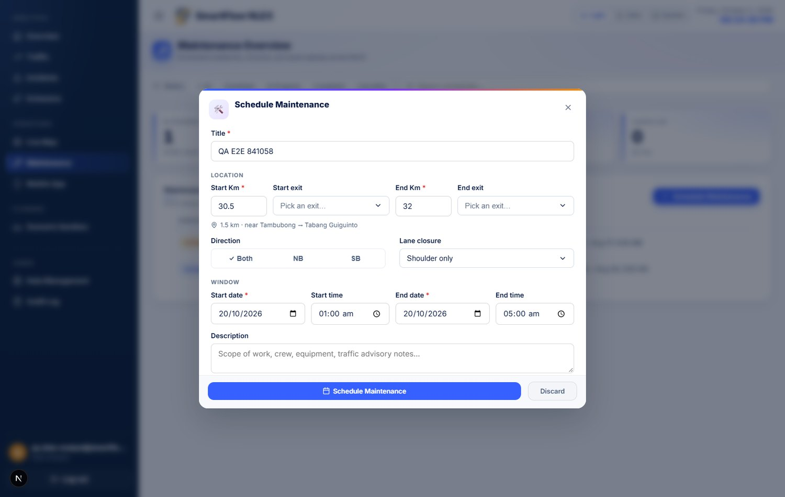

**Figure 4.1.37_maintenance-schedule-form** *Maintenance Scheduling Form with Kilometre Markers*


**Figure 4.1.37** *Maintenance Scheduling Form with Kilometre Markers*

#### 4.2.5.2 Interface

The page presents the schedule as a filterable list with a status chip on each
row, a counter per status, and a detail panel opened from any row. From that
panel an operator can edit the entry, advance its status, cancel it with a
reason, or delete it.

Cancelling and deleting are offered separately and are not alternatives:

- **Cancelling** keeps the row, marks it cancelled, and records a reason. This
  is correct for work that was genuinely planned and then called off — the
  corridor record should still show that a closure was intended for that window,
  because a reader asking why traffic behaved unusually that night is entitled to
  find it.
- **Deleting** removes the row. This is correct only for an entry that should
  never have existed: a duplicate, or a typed mistake.

The distinction is stated in the confirmation dialog rather than left to the
operator to infer, because two destructive-sounding actions side by side is
otherwise a guess.


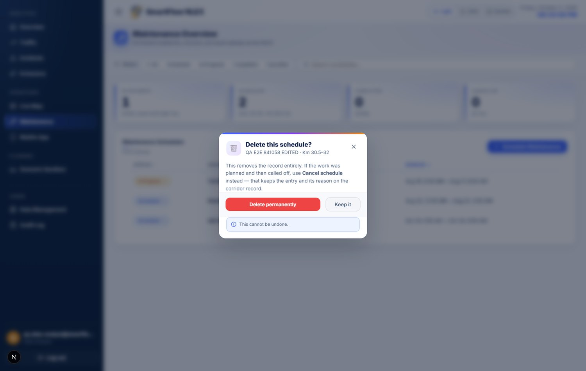

**Figure 4.1.38_maintenance-delete-confirmation** *Delete Confirmation, Distinguishing Deletion from Cancellation*


**Figure 4.1.38** *Delete Confirmation, Distinguishing Deletion from Cancellation*

#### 4.2.5.3 Interface to the Application Server

Five endpoints back the page. All validation is performed on the server; the
form's own checks are a convenience, and the server does not trust them.

**Table 4.2.14** *Maintenance Endpoints*

| Method | Path | Purpose | Answers |
| --- | --- | --- | --- |
| POST | `/api/maintenance/schedule` | Create | 201 created, 400 invalid, 503 database unreachable |
| GET | `/api/maintenance/list` | List, filterable by status | 200, 503 |
| PUT | `/api/maintenance/:id` | Replace an entry | 200, 400, 404, 503 |
| PATCH | `/api/maintenance/:id/status` | Advance or cancel | 200, 400, 404, 409 invalid transition, 503 |
| DELETE | `/api/maintenance/:id` | Remove an entry | 200, 404, 503 |

Two properties of this interface are worth recording.

**No mock fallback.** Where the database cannot be reached, every endpoint
answers 503 and says so. None substitutes placeholder data. The mobile
application consumes these same endpoints, and a fabricated success there would
place a closure on an operator's screen that does not exist in the warehouse.

**Every mutation is audited.** Creation, edit, status change, and deletion each
write an entry to the system's audit log, recording the actor
and what changed. The write is fire-and-forget: a failure in the audit path never
fails the operation the operator requested.

#### 4.2.5.4 Defects Identified and Corrected

Exercising the endpoints against their acceptance criteria revealed two faults.
Both concerned the boundaries of valid input rather than the main path, which is
why neither had surfaced in ordinary use.

**Table 4.2.15** *Maintenance Scheduler Defects*

| # | Defect | Consequence | Correction |
| --- | --- | --- | --- |
| 1 | The kilometre range was not ordered | A job could be saved running from Km 40 to Km 10. Every consumer reads the pair as a span, so a reversed entry yields a negative length: the dashboard draws nothing and the mobile application reports a closure of less than zero kilometres | The server now requires the end marker to be at or beyond the start. Equality is still permitted, since work at a single marker is a legitimate entry |
| 2 | Deletion did not check whether a row was removed | A `DELETE` against an identifier that did not exist answered 200 "Deleted" and wrote an audit entry for a deletion that never happened — the audit log recording an event the database never saw | Deletion now distinguishes the three outcomes and answers 404 where no row matched |
| 3 | A malformed identifier was reported as a database outage | The identifier reached the database, which rejected it as badly formed. The service treats every query failure alike and reports the database unreachable, so a mistyped identifier answered 503 — telling the operator the warehouse was down while it was healthy, and raising an infrastructure alarm for what was a bad request | The identifier is checked before the database is consulted, and an unparseable one answers 404 |

Defect 1 was not hypothetical. A record in the table at the time of the fix — a toll booth
repair entered as Km 76.25 to Km 73.23 — carried a reversed range that the validation would now
refuse. That record has since been replaced during testing, and no reversed range remains in the
table; the schedules now present all run forward along the corridor.

Defect 2 is the more instructive of the two. The update path had always
distinguished a missing row and answered 404; the delete path, written alongside
it, discarded the row count and reported success unconditionally. The two sat in
the same file. An interface can be inconsistent with itself in a way that no
single reading of either half reveals.

#### 4.2.5.5 Verification

The module was tested at two levels: the endpoints directly, and the delivered
interface driven through a browser with a signed-in operator account.

**Table 4.2.16** *Maintenance Scheduler Test Results*

| # | Scenario | Expected | Observed |
| --- | --- | --- | --- |
| 1 | Submit with empty fields | Rejected | 400, field named |
| 2 | Title shorter than three characters | Rejected | 400 |
| 3 | Negative kilometre marker | Rejected | 400 |
| 4 | Kilometre marker beyond the corridor | Rejected | 400 |
| 5 | End time before start time | Rejected | 400 |
| 6 | End marker before start marker | Rejected | 400 |
| 7 | Direction outside the enumeration | Rejected | 400 |
| 8 | Work at a single marker (start equals end) | Accepted | 201 |
| 9 | Valid submission | Created | 201, row returned |
| 10 | Edit an existing entry | Updated | 200 |
| 11 | Advance status | Updated | 200 |
| 12 | Cancel without a reason | Rejected | 400 |
| 13 | Cancel with a reason | Updated | 200 |
| 14 | Delete an existing entry | Removed | 200, absent from the list |
| 15 | Delete the same entry again | Rejected | 404 |
| 16 | Edit an entry that does not exist | Rejected | 404 |

Ten further checks were performed through the interface itself, signed in as a
Data Analyst: the scheduling form opened and accepted a complete entry; the saved
job appeared in the list; the detail panel opened; the entry was edited and the
change persisted; deletion asked for confirmation before acting; the deleted
entry left the list; and it remained absent after the page was reloaded, which
confirms the removal reached the database rather than only the browser's copy of
the list.

All twenty-six checks passed after the corrections in Section 4.2.5.4. A further
adversarial pass of twenty-four checks — boundary values at both ends of every
numeric and text field, malformed and absent timestamps, script and SQL payloads
in free-text fields, malformed identifiers, and every invalid status transition —
passed in full once defect 3 was corrected.

#### 4.2.5.6 Limitation: Status Is Not Reconciled with the Clock

A schedule's status is whatever an operator last set. Nothing advances it when
its window begins, and nothing closes it when the window passes.

The consequence is visible in the delivered system. Both records presently in the
table have windows that closed in August. One is still marked *in progress*, so
the page's summary reports three kilometres of carriageway "under work right
now" for work that finished forty-six days ago. The other is still marked
*scheduled*, which places a count of one beside a caption reading "nothing
upcoming" — the two disagree because the only scheduled item is in the past.

This is a design gap rather than bad data, and the proponents record it as such:
no amount of correcting these two rows prevents the third. Two resolutions are
available. A status could be *derived* for display — a window that has closed
shown as elapsed regardless of the stored value — which changes no data and no
interface contract. Alternatively a scheduled task could advance statuses as
windows open and close, which is closer to how an operations system should
behave but alters records the mobile application also reads, and so is the larger
change.

The proponents recommend the derived presentation as the immediate measure,
because a dashboard that reports current roadwork which ended six weeks ago is
wrong in the way most likely to be noticed and least likely to be forgiven.


---

## 4.3 Testing and Validation

Section 3.13 specifies unit, stress, and user-acceptance testing. This section reports the testing
actually carried out against the delivered system, the results obtained, and the one category of
testing that remains outstanding.

### 4.3.1 Functional and Boundary Testing

Testing was directed at the two modules that write to the warehouse or guard access to it, since a
fault in either is consequential in a way a visualisation fault is not.

**Table 4.3.1** *Access Control Test Results*

| # | Scenario | Expected | Observed |
| --- | --- | --- | --- |
| 1 | Sign-in, valid credentials and authenticator code | Session issued at aal2 | Issued; access token valid 3,600 s |
| 2 | Protected endpoint, valid token, permitted role | Served | 200 |
| 3 | Sign-in, unknown account | Refused | 400, generic message |
| 4 | Sign-in, wrong password | Refused | 400, identical message |
| 5 | Protected endpoint, no token | Refused | 401 `token_missing` |
| 6 | Protected endpoint, malformed token | Refused | 401 `token_invalid` |
| 7 | Upload endpoint, no token | Refused | 401 `token_missing` |
| 8 | Protected endpoint, valid token, wrong role | Refused, not retried | 403 `role_denied` |
| 9 | Refused request, refreshed, replayed | Succeeds without re-authentication | 401 → refresh → 200 |
| 10 | Public analytics endpoint | Served | 200 |
| 11 | Public endpoint, repeated | Served from cache | 200, `X-Cache: HIT` |
| 12 | Protected endpoint, repeated | Never served from cache | No cache header present |

Scenarios 3 and 4 return an identical message. This is deliberate: a response distinguishing "no such
account" from "wrong password" would allow an attacker to establish which addresses are registered.

Scenario 8 is the result that justifies the status-code design described in Section 4.2.4. A session
holding a valid, current token was refused with 403 rather than 401, so a client implementing silent
renewal does not attempt a refresh that could not change the outcome.

**Table 4.3.2** *Maintenance Scheduler Test Results*

| Group | Scenarios | Result |
| --- | --- | --- |
| Field validation | Empty submission; title below and at the minimum length; title at and beyond the maximum; description beyond the maximum; negative kilometre; kilometre beyond the corridor; end before start, in both time and distance; work at a single marker | All refused or accepted as specified |
| Temporal validation | Zero-length window; naive timestamp without offset; unparseable timestamp | All refused with the offending field named |
| Input handling | Script markup, SQL payload, and Unicode in free-text fields | Stored verbatim; parameterised queries intact; escaped on render |
| Identifier handling | Malformed identifier; path traversal; well-formed identifier matching no row | All answered 404 |
| State transitions | Advance, cancel without a reason, cancel with a reason, reopen a completed entry, invalid status value | All behaved as specified |
| Lifecycle, through the interface | Create, appear in list, open detail, edit, confirm deletion, removal persists across reload | All passed |

Forty checks were executed in total: sixteen against the endpoints, twenty-four adversarial, and ten
driven through the delivered interface with a signed-in operator. All passed following the
corrections recorded in Section 4.2.5.4.

### 4.3.2 Accessibility and Presentation Testing

Every dashboard page was audited in both the light and dark presentations. Each text-bearing element
was measured against the surface it is painted on, walking up the document tree where a background is
transparent, and compared against the 3:1 minimum specified for large text in WCAG 2.1.

**Table 4.3.3** *Contrast Audit Coverage and Result*

| Measure | Value |
| --- | --- |
| Pages audited | 10 |
| Presentations | Light and dark |
| Text-bearing elements measured | Approximately 10,000 |
| Elements below 3:1 | **0** |
| Elements not scored (painted over a gradient or image) | 4 to 6 per page |

The elements that could not be scored sit over a gradient or a background image, for which a single
computed background colour does not represent what is behind the text. These require visual
inspection rather than measurement, and are reported rather than counted as passes.

A standalone static analysis step was also established: the project declares ESLint 9, and the
project now carries a flat configuration so that linting runs outside the build. The current state is
**zero errors and 83 warnings**, the warnings being unused identifiers and exhaustive-dependency
advisories rather than defects.

### 4.3.3 Load and Concurrency Testing

The application server was exercised under concurrent load across five scenarios spanning its three
read profiles: an endpoint that touches no database, two cached analytical endpoints, an uncached
database read, and the live crowdsourced feed.

| Scenario | Concurrency | Requests | Succeeded | p50 | p95 | Max |
| --- | --- | --- | --- | --- | --- | --- |
| Health check (no database) | 50 | 500 | 500 | 28 ms | 36 ms | 41 ms |
| Traffic analytics (cached) | 25 | 250 | 250 | 29 ms | 44 ms | 53 ms |
| Incident analytics (cached) | 25 | 250 | 250 | 16 ms | 31 ms | 38 ms |
| Maintenance list (database read) | 25 | 250 | 250 | 12 ms | 27 ms | 36 ms |
| Live corridor feed | 15 | 120 | 120 | 7 ms | 23 ms | 30 ms |

**1,370 requests were issued and every one returned 200**, with the 95th percentile under 45 ms in
all five scenarios. The response cache described in Section 4.2.2 is visible in these figures: the
analytical endpoints, which answer in seconds on a cold request, serve a warm one in tens of
milliseconds.

The result bounds a claim rather than proving an absence of limits. The corridor has a known and
small operator population, and the concurrency tested comfortably exceeds it; what has not been
established is the point at which the server degrades, because it was not reached.

One behaviour is worth recording because it was observed rather than predicted. After a restart, the
first requests to a database-backed endpoint can fail while the connection pool is still being
established, and the endpoint reports that the database is unreachable. The database is reachable;
the pool is not yet warm, and subsequent requests succeed. An operator opening the dashboard within a
few seconds of a server restart may therefore see a panel report a database fault that does not
exist.

### 4.3.4 Testing Not Yet Performed

Two categories named in Section 3.13 are outstanding and are reported as such.

**Degradation limits.** Section 4.3.3 establishes that the server sustains the concurrency a corridor operations team would generate. It does not establish where the server fails, since that point was not reached, and no claim is made about behaviour beyond the levels tested.

**User-acceptance testing.** Two modules carry a UAT acceptance criterion. The Data Management module
records its user-acceptance subtask as complete. The Maintenance Scheduler's does not: its criterion
requires that maintenance coordinators evaluate the scheduling interface and confirm they can plan
and organise roadwork with it, and no such evaluation has been held. Heuristic evaluation by the
proponents is not a substitute and is not reported as one.

The proponents recommend that a short structured session be held with two or three evaluators who
were not involved in building the system, each given a realistic scheduling task and observed, with
the evaluators named in the record. Three questions already identified as likely to arise are
recorded in Section 4.4.3.

---


## 4.4 Limitations

The limitations below are stated so that the findings in this chapter are read against their proper
scope. They are grouped by what they constrain.

### 4.4.1 Limitations of Scope

**No controlled strategy comparison in the sandbox.** The simulation produces the metrics by which two
response strategies could be compared, and the comparison is not reported (Section 4.4.1).

**No field deployment.** No intervention recommended by the prescriptive tier has been applied to the
corridor, so no projected saving has been confirmed against an observed one (Section 4.1.5.3).

**No stress testing, and one outstanding user-acceptance evaluation** (Section 4.3.3).

**Analyses described in Chapter 3 that the delivered system does not implement.** Four are recorded:
a Gaussian Mixture Model separating operating regimes and an Underwood speed-flow fit yielding a
critical density; Getis-Ord Gi\* significance testing and a network-constrained kernel density
surface for incident hotspots; Geographically Weighted Regression for segment-level incident risk;
and TOPSIS closeness-coefficient ranking of response strategies. In each case the delivered system
provides an equivalent output by a simpler method — ranked densities, corridor forecasts apportioned
by historical share, and a quadrant prioritisation — which is reported in this chapter in place of
the method named in Chapter 3. The proponents recommend that Chapter 3 be reconciled to the delivered
methods rather than the methods retrofitted.

### 4.4.2 Limitations of the Models

**Volume forecasting is split-dependent.** At the 80/20 chronological split, Prophet is accepted with
MASE 0.989 — marginally better than a seasonal naive forecast. At the 90/10 split no candidate is
accepted, every model recording MASE at or above 1. Any single accuracy figure quoted for volume
forecasting must name its split.

**The incident model is diagnosed as overfitting.** The Negative Binomial GLM records a training R² of
0.514 against a test R² of 0.262. It remains the best candidate and beats its baseline at the one-to-
seven-day horizon, and the diagnosis is reported alongside the result rather than omitted.

**The corridor CO₂ model is not validated at the horizon it is presented at.** It is accepted on its
294-day holdout at MAPE 9.63 %, satisfying the fifteen percent threshold in Table 3.6.3, but
rolling-origin validation at the one-to-seven-day horizon records MASE 1.176 and the pipeline marks
that horizon unusable. The holdout result stands; the seven-day claim does not yet.

**Secondary incident risk discriminates modestly.** AUC 0.620 against a base rate of 11.5 % is better
than chance and short of strong discrimination.

**Rainfall is not a usable trigger.** The weather-incident model's predicted probability of a
high-incident day moves from 14.0 % at zero rainfall to 14.3 % at 100 mm. The model separates
high-incident days using its other features; rainfall is not the lever, and no rainfall-triggered
advisory is claimed.

### 4.4.3 Limitations of the Data

**Speed data that does not originate from the Waze feed is synthetic.** The warehouse's own model
evaluation records state that the weather-speed models were scored against a volume table whose speed
column is generated capstone data. The jam speeds reported in Sections 4.1.3.1 and 4.1.3.2 are real
Waze observations; the weather-speed models are not, and no operational claim rests on them.

**Clearance-time coverage is partial.** Mean time to clear is computed on 36.7 % of incidents: 11,803
of 40,497 breakdowns carry a usable duration, against 4,893 of 5,024 accidents. The breakdown figure
describes a minority of the events it covers.

**"Time to clear" is measured as report-to-response.** No scene-cleared timestamp exists in the
warehouse, so the survival model is built from the interval between report and responder attendance,
which is the best available proxy and not the same quantity.

**Fatal incidents are too rare to predict.** Eleven fatal events appear in the severity holdout and no
candidate model predicts that class; reported severity accuracy is carried by the dominant class.

**A proportion of incident locations cannot be resolved to an exit.** 0.9 % of logged locations in the
active range are excluded from the per-exit split, and the exclusion is stated on the panel itself.

**Two streams named in Chapter 3 are not present in the warehouse.** The Apprehension and Undercap
Table and the mobile application's community reports do not appear as data sources and contribute no
variable to any result in this chapter.

**One environment serves all stages.** A single warehouse instance backs development and operational
use, so no stage is isolated from operational data.


---

## Notes for the Group

*Decisions required before submission. Each names the section it affects.*

1. **Section 1.4.2 names RStudio, which the delivered work did not use** (Section 4.1.3.4). The analysis was carried out in Python across 174 scripts. The proponents recommend amending the objective to state Python alone rather than retrofitting R analysis to satisfy a tool list.

2. **Four methods described in Chapter 3 are not implemented** (Section 4.4.1): the regime separation and speed-flow fit, Getis-Ord Gi\* significance testing, Geographically Weighted Regression, and TOPSIS ranking. In each case the delivered system provides an equivalent output by a simpler method. The proponents recommend reconciling Chapter 3 to the delivered methods.

3. **Two figures require screenshots the proponents cannot capture from the running system**: the hosting console showing the application server's configuration with values masked, and the repository branch listing. Both require account access rather than the dashboard.

4. **One user-acceptance evaluation remains outstanding** (Section 4.3.3). The Maintenance Scheduler's UAT criterion requires maintenance coordinators to evaluate the interface. A short structured session with two or three evaluators who were not involved in building the system would close it, with the evaluators named in the record.

5. **Load testing is now reported in Section 4.3.3** — 1,370 requests across five scenarios, every one successful, p95 under 45 ms. What remains unestablished is the point of degradation, which was not reached.

6. **Chapter 5 should carry forward the three model limitations in Section 4.4.2** — the split dependence of volume forecasting, the overfitting diagnosis on the incident model, and the unvalidated seven-day horizon on corridor CO₂ — since each bears directly on what the system can be claimed to forecast.

7. Section 3.7 specifies a Tailwind CSS theme configuration as the design token
   mechanism. The delivered interface implements tokens as CSS custom properties
   instead, for the reasons given in Section 4.2.1.6. This follows the same
   convention already applied to Figures 4.1.9, 4.1.24, and 4.1.28, where the
   note beneath each screenshot records that the build differs from what the
   outline anticipated. The group should decide whether to record the deviation
   as written, revise Section 3.7 to match the delivered system, or complete the
   Tailwind configuration before submission.

8. Section 4.2.3.4 records that branch protection and pull-request review are not
   configured on the integration repository. This is a practice gap rather than a
   defect in the delivered system, and it can be closed before submission by
   changing three repository settings. The group should decide whether to close
   it and revise the section, or to submit it as recorded. The proponents note
   that a limitation stated plainly is defensible in a panel review, whereas a
   practice claimed and not implemented is not.

9. Three accounts were provisioned to produce Table 4.2.12, one per role, using
   addresses on a `.test` domain. They exist in the same identity project the
   panel will see, for the reason given in Section 4.2.4.8. The group should
   decide whether to keep them for the demonstration — they are what makes the
   role restrictions in Table 4.2.9 demonstrable — or remove them before
   submission. If they are kept, the shared password should be changed first.

   Section 4.2.4.6 records six corrected defects. If the group prefers Chapter 4
   to report only the delivered state, the table can be reduced to its
   right-hand column, though the proponents recommend against it, as the defects
   evidence the testing that found them.

10. Section 4.2.5.4 records an existing maintenance record whose kilometre range
    held a reversed kilometre range has since been replaced; none remains.
    What does remain are test records ("Ysa Test", "Ysa Test 2"), which should be
    removed before the demonstration. The group should also decide whether the
    corridor-facing views should additionally ignore any row whose range is
    reversed, as a defence against records created before the rule existed.

